<div align="center">
  <h1>Linux for Android Manager</h1>
  <p>Run a real Linux desktop on an Android phone, with Ubuntu, Debian, Kali, Arch, Fedora, openSUSE, Void, or Alpine.<br>One script, no root, verified on a 2016 phone and a 2026 phone.</p>
  <p>Created and maintained by <a href="https://github.com/pdev-labs">pdev-labs</a>, a solo developer.</p>
  <p>
    <a href="https://github.com/pdev-labs/Linux-For-Android/actions/workflows/ci.yml"></a>
    
    
    
    
  </p>
  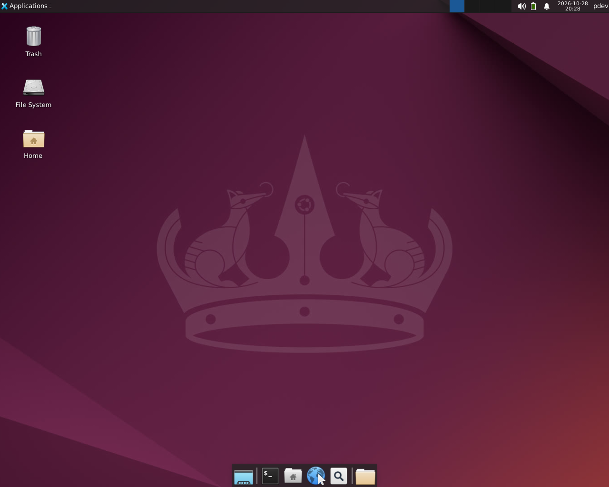
  <br>
  <sub>Ubuntu 24.04, XFCE4, and Termux:X11 on a Vivo V2437 running Android 16</sub>
</div>

> Known limitations are tracked in [issues.md](issues.md): 54 findings, with
> 38 fixed, 11 partial, and 5 deliberately deferred. Read it before installing
> anything experimental.

## Table of contents

- [Quick start](#quick-start)
- [Screenshots](#screenshots)
- [About the project](#about-the-project)
- [Verified on real hardware](#verified-on-real-hardware)
- [Hard problems solved](#hard-problems-solved)
- [GNOME (experimental)](#gnome-experimental)
- [Key features](#key-features)
- [Installation](#installation)
- [Wayland sessions](#wayland-sessions)
- [Older and custom distro versions](#older-and-custom-distro-versions)
- [First-run setup](#first-run-setup)
- [Older devices (Android 5/6)](#older-devices-android-56-eg-oppo-a37fw)
- [Usage guide](#usage-guide)
- [Software and app fixes](#software-and-app-fixes)
- [Software that cannot run](#software-that-cannot-run) and [full compatibility list](docs/INCOMPATIBLE.md)
- [Troubleshooting index](#troubleshooting-index) and [detailed guide](docs/TROUBLESHOOTING.md)
- [Android CI](docs/CI-ANDROID.md)
- [Architecture](docs/ARCHITECTURE.md), [design decisions](docs/DECISIONS.md), and [changelog](CHANGELOG.md)
- [Known issues](issues.md), [contributing](CONTRIBUTING.md), and [security](SECURITY.md)
- [Credits](#credits)
- [License](#license)

## Quick start

```bash
# 1. Install Termux from F-Droid (never the Play Store build)
# 2. Then, in Termux:
pkg update -y && pkg install git -y
git clone --depth 1 --branch v1.7.1 https://github.com/pdev-labs/Linux-For-Android.git
cd Linux-For-Android && ./install_linux.sh
```

Choose Guided setup, pick a distro and desktop, answer a few questions, and you
get the `linux` desktop shortcut, the `lfa` command line, and the classic
`start-linux` / `stop-linux` commands plus a home-screen shortcut. Pin a
different version by changing `--branch`. `main` is development.

Requirements: about 1 GB free for a CLI install, 2.5 GB for a desktop, and
3.5 GB for GNOME. Android 5.1 or newer. The installer checks free space before
it starts.

## Screenshots

All captured on real devices, not mockups. Notification-bar icons are removed.
Everything below the status bar is the live session.

| Ubuntu 24.04, XFCE | Ubuntu, dark mode |
|---|---|
|  | 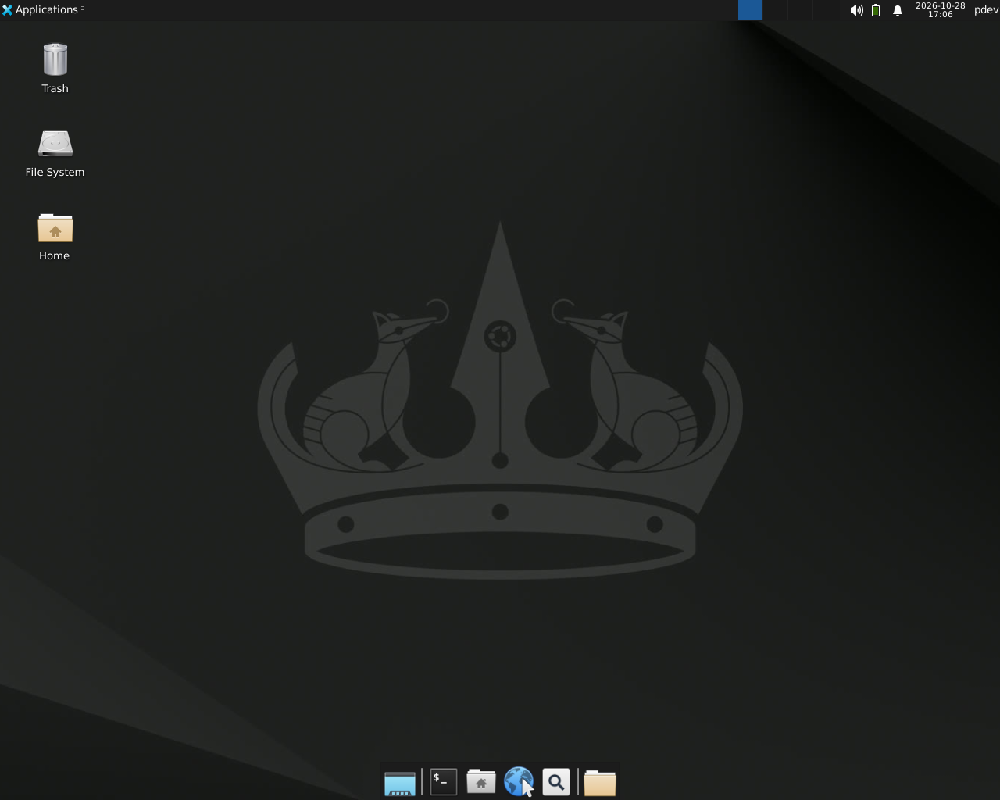 |

| Kali Rolling | Arch Linux ARM |
|---|---|
| 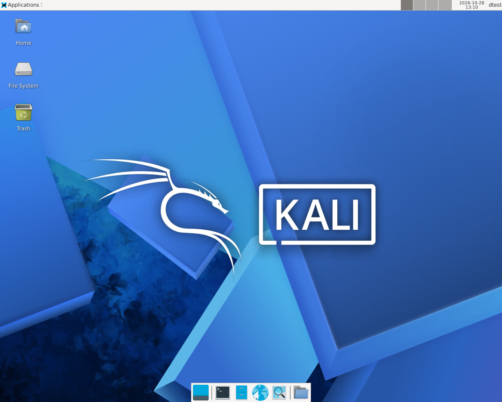 | 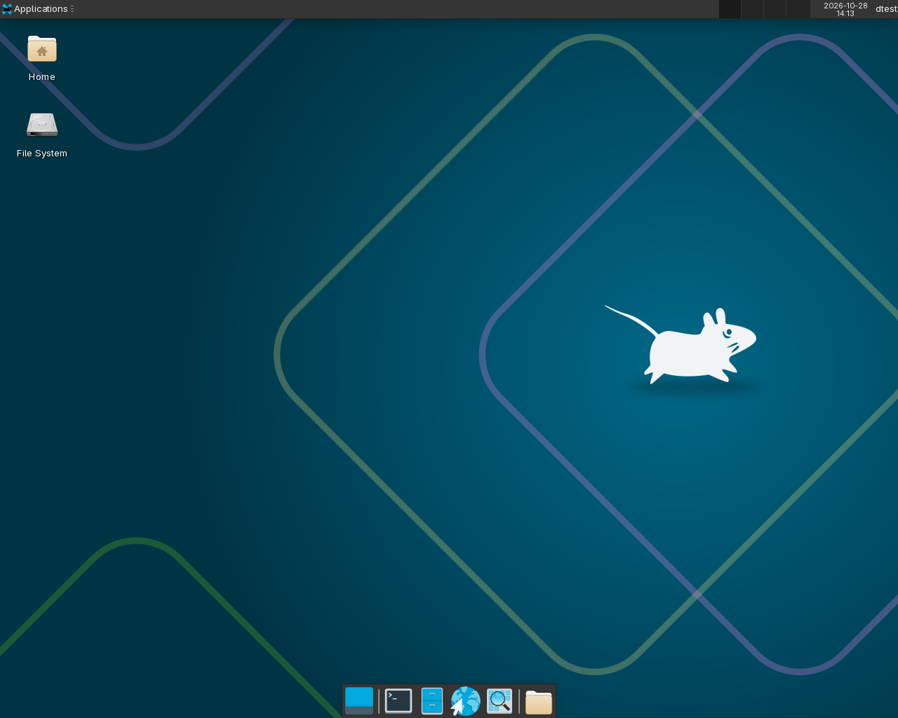 |

| Alpine Linux | GNOME 46 (experimental) |
|---|---|
| 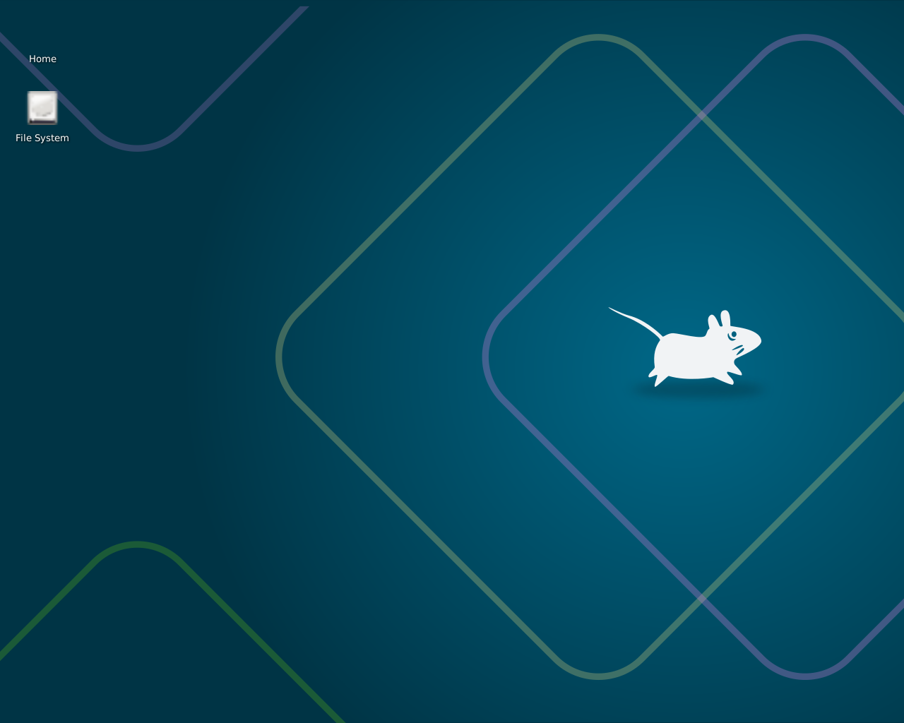 | 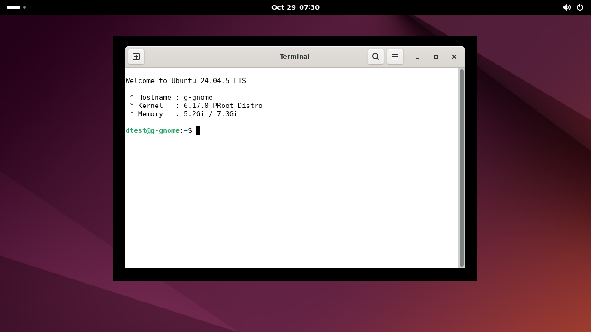 |

Android 5.1.1 on the 2016 Oppo A37fw, running Alpine 3.18 in legacy mode over
VNC:

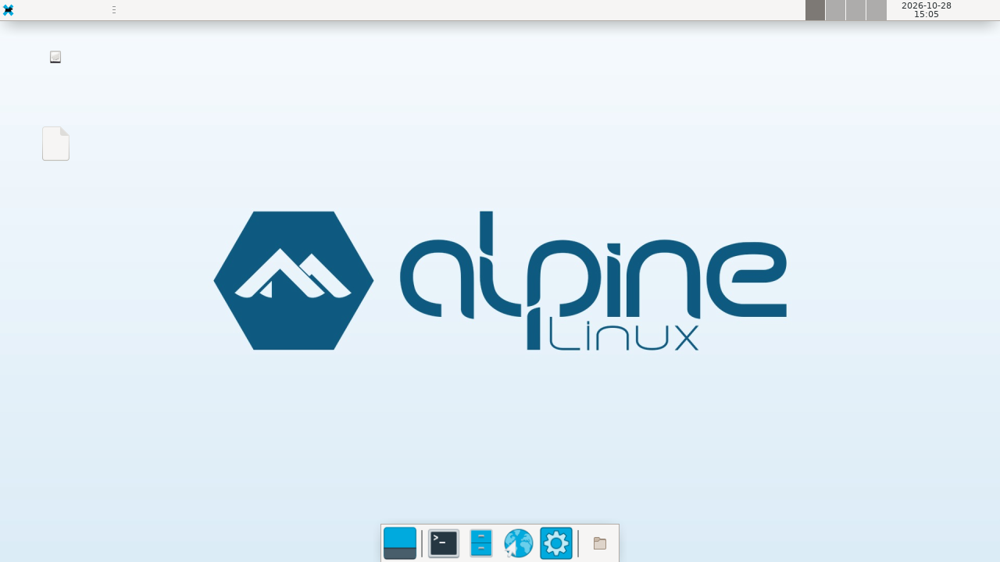

Application screenshots for VS Code, Firefox, Chromium, LibreOffice, GIMP, VLC,
Antigravity, and the CLI tools are in
[Software and app fixes](#software-and-app-fixes).

## About the project

Linux for Android Manager runs a graphical Linux environment on an Android
phone without root. It is an interactive Bash script that wraps
`proot-distro` to install and manage Linux distributions on a phone or tablet.

Supported distributions:

- Ubuntu (apt)
- Debian (apt)
- Kali Linux (apt)
- Arch Linux (pacman)
- Fedora (dnf)
- openSUSE (zypper)
- Void Linux (xbps)
- Alpine Linux (apk, musl, recommended for Android 5/6)

> Android 5/6 devices with a 3.10 kernel are detected automatically. The script
> installs `proot-distro` v4.2.0 from source when the package is missing,
> forces VNC instead of Termux:X11, and skips VirGL. Alpine (musl) and Debian
> (auto-switches to bullseye, glibc 2.31) are verified working there. Modern
> glibc distributions such as bookworm, Ubuntu mantic, and Fedora 39 cannot
> execute on a 3.10 kernel.

## Verified on real hardware

Every distribution below was installed and its desktop launched on physical
hardware, not simulated. Full details, root causes, and evidence are in
[docs/TEST-REPORT.md](docs/TEST-REPORT.md).

| Device | Android | Kernel | Backend |
|---|---|---|---|
| Vivo V2437 | 16 (SDK 36) | 6.1.145 | Termux:X11 and VNC |
| Oppo A37fw | 5.1.1 (SDK 22) | 3.10 | VNC (legacy mode) |

| Distro | Install | Live desktop | Notes | Verified on |
|---|---|---|---|---|
| Ubuntu 24.04 | Yes | Yes | light and dark; Both backends installed and each launched (2026-11-04) | v1.7.1 |
| Kali Rolling | Yes | Yes | | v1.7.0 |
| Fedora 44 | Yes | Yes | | v1.7.0 |
| openSUSE Tumbleweed | Yes | Yes | first login shows a PulseAudio panel warning | v1.7.0 |
| Arch Linux ARM | Yes | Yes | | v1.7.0 |
| Void Linux | Yes | Partial | X11 works; panel inconsistent over VNC | v1.7.0 |
| Alpine Linux (edge) | Yes | Partial | desktop and wallpaper render; `xfce4-panel` does not start | v1.7.0 |
| Alpine 3.18 (Android 5) | Yes | Yes | legacy VNC desktop, panel works; X11 and Both hidden | v1.7.1 |
| Ubuntu GNOME 46 (experimental) | Yes | Yes | shell and apps run; session services missing | v1.7.0 |

> The test suite runs `677` checks with 0 failures. The same suite runs on the
> devices (`tests/device-matrix.sh`). The table is as of v1.7.1. Ubuntu was
> re-verified on v1.7.1, and Alpine 3.18 was re-verified on Android 5 on
> 2026-11-04; the other rows were last verified on v1.7.0. A row is
> marked verified only after a real install on the device named above.

Fresh v1.7.0 capture: Ubuntu 24.04, XFCE4, and Termux:X11 on the Vivo V2437
(Android 16), 2026-10-31, with the suite and `--diagnostics` verified in the
same session:

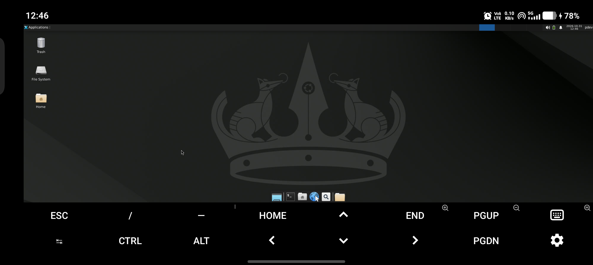

### Measured on hardware

| Measurement | Value |
|---|---|
| Alpine 3.18, XFCE, and VNC on the Oppo A37fw (2016) | 3m 32s, 204 MB |
| Ubuntu 24.04 and GNOME 46 on the Vivo V2437 | 27m 45s, about 2.5 GB |
| Desktop cold start (XFCE, X11 on the Vivo) | about 10 seconds after `start-linux` |
| GNOME over software rendering | 1 to 7 FPS video playback, usable shell |

## Hard problems solved

These failures were found on a device, diagnosed, and fixed. The notes are in
`docs/TEST-REPORT.md`.

- GNOME died before its first frame. `gnome-shell` asks logind for suspend and
  lock state over the system bus, which proot does not have, so
  `Gio.DBus.system` threw and the shell aborted. The fix points
  `DBUS_SYSTEM_BUS_ADDRESS` at a private daemon with no logind, so the lookup
  fails softly.
- Every GTK app exited with status 8. proot starts sessions with an empty
  `LANG`; glib reports it as ASCII, and GTK refuses to start. The fix is
  `C.UTF-8` plus `dbus-update-activation-environment --all`, which
  `gnome-session` normally does.
- `snapd` permanently broke `apt`. Ubuntu's snap packages cannot run in proot
  because there is no `CAP_SETFCAP`, no mounts, and no systemd. A
  half-configured `snapd` wedged dpkg. Doctor purges it and pins it out with an
  APT preference file.
- VNC refused to start after an X11 session with "display :1 is taken". The
  fix releases the socket and lock, but only when no process whose argv[0] is
  a real X server holds `:1`. `pgrep -f` alone matches the launcher's own
  command line.
- Android 5.1 could not run Debian 12 at all. Modern glibc aborts on the 3.10
  kernel at the first guest command. The fix auto-switches to Debian bullseye
  (glibc 2.31) or Alpine (musl), and it was verified on a 2016 phone.
- TigerVNC 1.15 and later killed the session when the xstartup returned. The
  fix uses a foreground `exec` session plus a proot keepalive, because
  `proot --kill-on-exit` reaps the server otherwise.
- Thunar drew a gray X on every folder in Android shared storage. Android
  mounts the tree as `1023:1023` with mode `2770`, and the desktop user was
  outside group 1023. Reads and writes worked, so the X was false. The fix
  makes gid 1023 the user's primary group.
- `/storage/emulated/0/Android/data` and `Android/obb` stayed closed even
  after "All files access". Android 11 and later deny both folders to every
  app, including Termux, so the guest cannot open them. `lfa storage data`
  copies an app's folders through adb, which runs as the shell user.

## GNOME (experimental)

> Status: BETA and EXPERIMENTAL. It is not a supported desktop. Expect crashes
> and missing features. Do not use it for anything you depend on.

> Hardware validation: GNOME Shell does start and render on the Vivo (Android
> 16, Ubuntu 24.04, GNOME 46) over both Termux:X11 and VNC, and
> `gnome-terminal` runs inside it. It is still beta. The session services below
> are missing, and the first login opens with the overview.

Guided setup offers GNOME (experimental) as option 5, but only on Ubuntu,
Debian, Kali, Arch Linux, Fedora, and openSUSE, and only on Android 8 or newer.
It is hidden on Android 5/6, Alpine, and Void, where it cannot be installed.

### Why it is experimental

A normal GNOME session starts `gnome-session`, which requires systemd and
logind. Neither exists inside proot. This option skips `gnome-session` and
launches `gnome-shell --x11` directly inside a D-Bus session.

The shell itself runs. The session services that `gnome-session` normally
starts do not, which is where the breakage comes from.

Two proot-specific patches make it start:

1. A private system bus. GNOME Shell asks logind for suspend and lock state
   while building the background. proot has a session bus but no system bus, so
   `Gio.DBus.system` throws "A connection to the bus can't be made" and the
   shell dies before the first frame. The launcher points
   `DBUS_SYSTEM_BUS_ADDRESS` at a private daemon that has no logind.
2. A UTF-8 locale. proot starts the session with an empty `LANG`, which glib
   reports as `ANSI_X3.4-1968`. GTK apps then refuse to start with "Non UTF-8
   locale ... is not supported!" and `gnome-terminal` exits with status 8. The
   launcher sets `LANG=C.UTF-8` and publishes the environment with
   `dbus-update-activation-environment --all`, which `gnome-session` would
   normally do.

### What is missing or broken

- Login and logout menu, session saving, and session restore
- Screen locking, idle blanking, and suspend or inhibit
- Some panel and dock entries, and the app grid on first login
- GNOME Settings (`gnome-control-center`) may crash, especially the Sound
  panel. The usual workaround wipes `~/.cache ~/.config ~/.local`, which also
  wipes your settings.
- Portals, auto-mount, polkit prompts, UPower and brightness, and
  notifications are partial or absent
- Extensions that need root or Android files do not work
- Touch input often only works in mouse mode
- Video playback runs at about 1 to 7 FPS because rendering is software-only
- Termux:X11 crashes the session often. VNC is pre-selected and is more stable
  for GNOME.
- A package upgrade that updates systemd or gdm can break the session. If that
  happens, run menu 0 (Doctor), then `start-linux` again.
- GNOME 49 and later removed the X11 session. The launcher detects this and
  refuses with a clear message instead of showing a black screen. Use a release
  with GNOME 48 or older.
- Under software rendering the window shadow is drawn as a solid black
  rectangle, and the first login opens in the overview instead of the desktop.

### Requirements

- Android 8 or newer. Android 5/6 is not supported.
- 3 GB RAM minimum, 4 GB or more recommended. It is heavy.
- About 2.5 to 3 GB of free storage.
- Ubuntu, Debian, Kali, Arch, Fedora, or openSUSE. Not Alpine and not Void.

### The warning is not optional

Selecting it prints the full warning and requires an explicit Yes. If you
decline, the installer falls back to XFCE4. Bug reports for GNOME are accepted
as experimental only.

> If you want a stable GNOME-family desktop today, use MATE (option 3). It has
> the same GTK and GNOME 2 heritage, needs no systemd or compositor, and is
> covered by the test suite and the verified matrix above.

## Key features

### Desktop experience

- `start-linux` and the standalone `terminal-linux` shortcut ask every boot
  whether you want a root terminal with full admin access or the `user`
  terminal. Terminal modes do not start display or audio servers.
- The guest has an Ubuntu-style colored prompt with the hostname you chose, a
  login banner, a `hostname` command that reports that name, colorised `ls` and
  `grep`, and Termux and Android variables removed from `env`. There are no
  proot caveats or "use the root terminal" notices in the guest.
- Every GUI install gets the selected distribution's real default wallpaper:
  Ubuntu 24.04, Debian 13, Kali 2026, Fedora 44, openSUSE Tumbleweed, Arch's
  official `archlinux-wallpaper` wave pair, and official Void and Alpine
  artwork. Guided setup asks for the light or dark variant. The chosen image is
  bundled, staged into the guest, and applied on desktop login through an XDG
  autostart entry. CLI-only installs skip wallpaper setup.
- Real setuid elevation is impossible inside proot on Android, so the project
  ships a ritual-only `sudo` shim. It asks for the install password, then runs
  the command with the access you already have.
- The installer uses arrow-key menus with descriptions, Enter to choose, Space
  to toggle packages, y/n confirmations, and coloured status screens. You can
  also type an option number, including multi-digit ones such as `10`. When
  stdin is piped, as in CI or `curl | bash`, every menu falls back to numbered
  prompts so automation does not hang.
- The software menu maps each choice to the right package for APT, DNF,
  Zypper, XBPS, Pacman, or APK. It includes `python3-pip` and `py3-pip`, real
  Firefox, Chromium, LibreOffice, GIMP, VLC, VS Code, Node/npm, and Google
  Antigravity IDE.
- Ubuntu 24.04 and later ship snap-only Firefox and Chromium, which cannot run
  in proot. The manager installs the official Mozilla ARM64 Firefox tarball and
  Debian bookworm's Chromium, with an APT pin that keeps them from being
  replaced by snap stubs.
- Google Antigravity IDE installs the official ARM64 build into
  `/opt/antigravity-ide` and launches it with the dbus and GPU flags it needs
  inside proot. It is the real IDE, not a placeholder terminal edition.
- The managed `/etc/lfa-chromium-flags` file lets the acceleration menu add or
  remove VirGL flags without overwriting the proot-safe Chromium wrapper.
- The uninstaller shows the instance, distro and desktop, rootfs path, and
  size. It asks for confirmation, stops active sessions, verifies removal, and
  cleans up half-deleted containers or legacy ghost entries left by older
  versions.
- The manager understands proot-distro v3, v4, and v5. It reads the rootfs from
  `installed-rootfs/` or `containers/<name>/rootfs`, understands v5 OCI image
  installs such as `alpine:latest`, and supports its `restore FILE` interface.
  Doctor, migration, backup and restore, and the launchers work on all layouts.
- Android 5/6 devices are detected and get proot-distro v4.2.0 from source,
  forced VNC, Alpine and Debian bullseye options, and workarounds for old
  proot.
- VirGL configures `virglrenderer-android` and passes 3D OpenGL rendering to
  the phone's GPU.
- Choose VNC for software rendering or Termux:X11 for a hardware-accelerated
  desktop. Guided setup can also install both. With both, `linux` and
  `start-linux` ask which backend to use and remember the last desktop choice.
  `lfa switch x11|vnc|both` changes the backend later. Terminal-only sessions
  do not change that choice.
- `lfa switch <backend> --remove-old` removes the packages of the backend
  you are leaving. Termux:X11 is shared between distros, so the manager refuses to
  remove it while another installed distro still uses it unless `--force` is
  given. Android 5/6 refuses X11 and Both switches and explains how to restore
  VNC if its packages are ever removed by hand.
- If a desktop was running, `lfa switch` restarts it on the new backend;
  `--no-start` leaves it stopped. A second `linux`/`start-linux` for the same
  instance is refused instead of starting a competing session, and
  `linux --restart` replaces a wedged one. This is what prevents the
  "two session managers, no window manager, cross cursor" state.
  `lfa start --restart` forwards to the same flag.
- A scoped `gpgconf` guard keeps `xfce4-session` from waiting forever on
  `gpgconf --kill gpg-agent` under proot. Without it the session never reaches
  `xfwm4` and the screen stays on the root cross cursor. A cursor-theme helper
  runs from XDG autostart as a second line of defence.
- GNOME compatibility and XFCE session restore are off for desktop sessions.
  A keyring cannot be unlocked without PAM, and restoring the last session
  kept bringing the locked-keyring prompt back on every login.
- VNC uses a modern TigerVNC config, an `exec`-style desktop session, and a
  persistent proot keepalive so `--kill-on-exit` cannot kill the server. The
  keepalive is a single `exec sleep`, so `stop-linux` can terminate it.
  `stop-linux` cleans up the server and its PID file.
- Repository and package operations retry. The installer refuses to print
  "Installation complete" when the chosen desktop or VNC components are
  missing.
- Display settings let you pick the resolution and UI scaling: Auto, 720p,
  1080p, or Tablet.

### Reliability and security

- Free-space preflight refuses a 2.5 to 3.5 GB install on a device that cannot
  hold it, instead of dying halfway through `apt`.
- The generated guest script holds install passwords in a mode-`0600` file that
  is deleted after use and on Ctrl-C.
- The sudo shim stores a salted SHA-256 hash, never the password, and is mode
  `0700`.
- The Microsoft signing key is checked by fingerprint before the VS Code
  repository is added. Scraped download URLs are restricted to the vendor's
  own hosts, and the legacy proot-distro tree is validated.
- Pidfiles are matched against the process command line before anything is
  killed, so a recycled PID cannot hit an unrelated process.
- A failure anywhere in a pipeline fails the step. This caught two real bugs
  in the dashboard.
- A cached, 3-second, non-blocking check tells you when a newer release exists.
  `LFA_NO_UPDATE_CHECK=1` disables it.

### Automation and management

- The manager menu detects the distro and updates it.
- Doctor (menu 0) sanitises `dpkg`'s `statoverride`, reinstalls the proot-safe
  `dpkg-statoverride` shim, re-applies apt hardening, finishes half-configured
  packages with `dpkg --configure -a`, and audits the package database. It is
  safe to run any time.
- Apply Latest Fixes (menu 12) updates a distro installed by an older version
  without reinstalling. It runs Doctor, adds new config keys (`USER_NAME`,
  `COLOR_MODE`, `TIMEZONE`, `HOSTNAME`, `NEED_VIRGL`), bakes the hostname into
  the shell prompt, refreshes the VNC `xstartup`, re-applies the saved light or
  dark wallpaper for GUI instances, regenerates `start-linux`,
  `terminal-linux`, `stop-linux`, `linux`, and `lfa` from the current
  templates, updates the legacy bullseye plugin, rebuilds `libuid0` if missing,
  and repairs EOL apt sources. The same migration runs without the menu:
  `lfa fix -i NAME`.
- Change Display Backend (menu 14) switches X11, VNC, or Both in place and can
  remove the packages of the backend being left.
- The system dashboard shows Android RAM availability, Termux storage use, and
  CPU architecture.
- The audio fixer restarts PulseAudio and binds it to TCP protocols to resolve
  audio crackling.
- The browser menu can force hardware-accelerated video decoding with
  `--enable-gpu-rasterization` and `--use-gl=egl`.
- Start a native SSH server on port 8022 from the menu.
- `lfa storage` repairs the shared-storage links and the false Thunar X, runs
  scripts from shared storage without `chmod`, and copies `Android/data` and
  `Android/obb` through adb.

### Portability and convenience

- Export a customized Linux install as a `.tar.gz` file in the Android
  `Downloads` folder. Another user can place the file in `Downloads` and use
  Import to clone the setup.
- If Termux:Widget is installed, the script generates shortcuts for
  `Start-Linux` and `Terminal-Linux`.

## Installation

### Prerequisites

Download and install [Termux](https://f-droid.org/en/packages/com.termux/) from
F-Droid.

> Warning: do not use the Google Play Store version of Termux. It is outdated
> and broken.

### Install a release

Pin the version you install. `main` is development and may be mid-change.

```bash
pkg update -y && pkg install git -y
git clone --depth 1 --branch v1.7.1 \
  https://github.com/pdev-labs/Linux-For-Android.git
cd Linux-For-Android
chmod +x install_linux.sh
./install_linux.sh
```

### Command line

The installer itself keeps its original flags:

```text
-h, --help       show usage and exit
-V, --version    print the version
    --list       list installed distributions
    --doctor     repair the selected distribution
    --yes        quick setup, all defaults, no menus
    --debug      keep the generated guest script for inspection
```

`--help` and `--version` work outside Termux too. Everything else still has
its interactive path in the menu.

After an install, `lfa` is the command line for day-to-day work. It is a
private copy of the manager, so it keeps working if the cloned repository is
moved or deleted. `-i` is shorthand for `--instance` everywhere the long form
is accepted.

| Command | What it does |
| --- | --- |
| `lfa install` | install without menus; accepts `--distro`, `--desktop`, `--backend`, `--autostart`, `--user`, `--hostname`, `--timezone`, `--software`, and `-i` |
| `lfa list` | list installed distributions (`--json` for scripts) |
| `lfa status` | show desktop, backend, autostart, and running state (`--json`) |
| `lfa start` | start the desktop; `--x11` or `--vnc` forces a backend, `--restart` replaces a running session |
| `lfa shell` | open a terminal; `--root` or `--user` picks the account |
| `lfa stop` | stop a desktop; `--all` stops every instance |
| `lfa switch` | switch `x11`, `vnc`, or `both`; see below |
| `lfa autostart` | set boot desktop to `x11`, `vnc`, or `none` |
| `lfa update` | update one distribution |
| `lfa fix` | apply the latest manager fixes to one distribution, no menus |
| `lfa doctor` | repair apt/dpkg and the manager files |
| `lfa backup` | write `~/<instance>-backup.tar.gz` |
| `lfa restore` | restore a backup file |
| `lfa remove` | delete a distribution (`-y` skips the question) |
| `lfa compat` | list, explain, enable, or disable compatibility shims |
| `lfa android` | check, install, test, and enable the Termux:API bridge |
| `lfa appimage` / `lfa app` | extract an AppImage once and add a menu entry |
| `lfa run` | run an AppImage once without installing it |
| `lfa storage` | Android storage status, repair, run, and protected data helpers |
| `lfa wayland` / `lfa wl` | nested Wayland session: install, start, stop, status, doctor, and compositor choice |
| `lfa diagnostics` | write a redacted support bundle |
| `lfa notice` | `on`, `off`, or `status` for the `start-linux` change notice |
| `lfa version` / `lfa help` | version and command list |

Examples:

```bash
lfa install --distro ubuntu --desktop xfce4 --backend both -i ubuntu
lfa start -i ubuntu --vnc
lfa shell -i ubuntu --user
lfa switch x11 -i ubuntu --remove-old
lfa autostart vnc -i ubuntu
lfa install --distro debian --desktop xfce4 --software python,git,htop -i dev
lfa compat list
lfa android test
lfa appimage add ~/Foo.AppImage
lfa appimage run Foo
lfa storage status
lfa wayland install -i arch --resolution 2408x1080
lfa wayland start -i arch
lfa wayland status -i arch
lfa notice off
```

When more than one distribution is installed, commands that operate on one
instance require `-i` instead of guessing. `lfa start`, `lfa shell`, and
`lfa stop` otherwise reuse the last instance you started.

### Compatibility shims and the Android bridge

Two optional layers make missing components easier to diagnose:

```bash
lfa compat list                         # what can be shimmed, and how honestly
lfa compat explain docker               # why an entry is not shimmable
lfa compat enable systemctl -i ubuntu   # tiny service supervisor in the guest
lfa compat disable systemctl -i ubuntu

lfa android status                      # Termux:API and bridge state
lfa android install                     # install the termux-api client package
lfa android test                        # read-only battery/location/clipboard probes
lfa android enable battery -i ubuntu    # guest tools read real Android battery data
```

`lfa compat` is the Linux side: it maps `systemctl`, `loginctl`, `upower`,
`snap`, and `bwrap` calls to small, visible fallbacks. `lfa android` is the
Android side: it exposes real framework data through files in `$PREFIX/tmp`
(the guest sees them as `/tmp`). They are separate on purpose, so a shim can be
disabled without losing hardware data, and the risky parts are easier to
audit.

Neither layer pretends to provide a kernel feature. Docker, Podman, Flatpak,
TUN/TAP, iptables, CUDA, ROCm, KVM, and kernel modules remain unavailable.
The full list, with reasons, is in
[docs/INCOMPATIBLE.md](docs/INCOMPATIBLE.md).

### AppImages

An AppImage normally mounts itself through FUSE. proot does not expose
`/dev/fuse`, so a raw `./Foo.AppImage` fails with
`fuse: failed to open /dev/fuse: Permission denied`. LFA does not pretend
FUSE works; it runs the AppImage the way the runtime supports, by extracting:

```bash
./Foo.AppImage                    # works: the session exports APPIMAGE_EXTRACT_AND_RUN=1
lfa run ~/Foo.AppImage            # run once, without installing
lfa appimage add ~/Foo.AppImage   # extract once and add a menu entry
lfa appimage list                 # name, app title, install date
lfa appimage run Foo              # launch the installed copy
lfa appimage remove Foo -y        # delete it
```

`lfa appimage add` is the better choice for large apps: it extracts to
`~/.local/opt/appimages/<name>`, writes a launcher in `~/.local/bin`, and adds
a desktop entry, so the menu and the command line share one copy. Direct
execution re-extracts on every launch, which is fine for small tools but slow
for a 100 MB launcher.

Extraction uses `/tmp` (the Termux tmp directory, shared with the guest), so
make sure the phone has free space for the unpacked app. An AppImage that
bundles glibc programs still needs a glibc guest; that part is unchanged by
the extraction method.

### Android storage

Android shared storage appears at `/storage/emulated/0`. LFA also links the
Termux folders under `~/storage`, adds `~/Android`, and puts a Thunar bookmark
and a desktop shortcut in place. `lfa storage fix` recreates the links and
sets the desktop user's primary group to gid 1023.

Android mounts the tree as `1023:1023` with mode `2770`, so a user outside
group 1023 makes Thunar draw a false "unreadable" X on every folder, even
though reads and writes work. The group change removes the X. Restart the
desktop after running the fix.

`chmod` does not work on shared storage. Android generates the permission bits
and mounts the tree `noexec`, so `chmod +x` is ignored even as root. Keep
scripts and binaries in the guest filesystem, or run them through the helper:

```bash
lfa storage status
lfa storage fix -i ubuntu
lfa storage exec /storage/emulated/0/script.sh
lfa storage exec --interpreter python3 /storage/emulated/0/tool.py
```

`lfa storage exec` copies the file to `/tmp`, sets the mode there, runs it,
and removes the copy. `lfa storage status` shows the Termux permission, the
guest group, write access, and the chmod result. The same helper is installed
in the guest as `lfa-run-file`, and Thunar gets a **Run in Linux** entry in the
right-click menu for files under shared storage.

### Android/data and Android/obb

Android 11 and later block `/storage/emulated/0/Android/data` and
`/storage/emulated/0/Android/obb` for every app, including Termux. The guest
runs as Termux, so it cannot open them, and `chmod`, a bind mount, or "All
files access" does not change that. adb runs as the shell user and is allowed
in, so LFA copies the folders on demand:

```bash
lfa storage data status
lfa storage data list
lfa storage data pull com.example.app both
```

The default destination is `~/storage/shared/Android-backup/<package>`, which
the guest sees at `/storage/emulated/0/Android-backup/<package>`. Pass
`--dest DIR` to put it elsewhere. The copy is a snapshot; changes go back to
the live folder only through adb. The copy is in shared storage, so other apps
can read it. Delete it when you are done.

The data commands need the adb client in Termux and a connection to the
phone's own adbd. Install the client once:

```bash
pkg install android-tools
```

From a PC with USB debugging enabled, run:

```bash
adb tcpip 5555
```

Then `lfa storage data status` connects to `127.0.0.1:5555`. The connection
lasts until the phone reboots. After a reboot, run `adb tcpip 5555` again, or
enable Wireless debugging and pair Termux's adb once.

## Wayland sessions

Termux:X11 is an X11 server, so a Wayland compositor has to run nested inside
it. `lfa wayland` installs Sway with a profile that copies the Hyprland look,
starts it, and stops it. Hyprland is installed too, and started instead when
the phone has a DRM render node that an app can open.

The stock phone does not have one. `/dev/dri/card0` is owned by
`system:system` with mode `660`, and there is no `/dev/dri/renderD128`.
Hyprland's Aquamarine back end needs a render node for dmabuf, so it exits with
`CBackend::create() failed!`. Sway with the pixman renderer does run nested on
X11. The profile keeps the host keybinds, gaps, borders, colours, Waybar,
SwayNC, wallpaper, and the Android battery reading.

```bash
lfa wayland install -i arch --resolution 2408x1080
lfa wayland install -i arch --config ~/hypr-config.tar.gz
lfa wayland start -i arch
lfa wayland status -i arch
lfa wayland doctor -i arch
lfa wayland stop -i arch
```

`--config` imports `hypr`, `waybar`, `kitty`, `wofi`, and `swaync` directories
from a folder or a tarball. `--resolution` sets the nested output size, which
is useful because the phone panel is portrait. `lfa wayland session` chooses
`auto`, `hyprland`, `sway`, or `xfce`.

The Vivo V2437 was tested at 2408x1080 with Waybar, SwayNC, SwayBG, the
launcher, the battery bridge, and a working `grim` screenshot. Hyprland
0.57.1 parses the host config but cannot start on that device. Full detail,
logs, and the DRM explanation are in [docs/WAYLAND.md](docs/WAYLAND.md).


## Older and custom distro versions

The installer defaults to one image per distro. On proot-distro builds that
support OCI images, you can override the tag for a single run with an
environment variable. The tag must exist in the upstream registry and must
include an arm64 build, because the guest runs on the phone's CPU without
emulation.

| Distro | Variable | Default image |
| --- | --- | --- |
| Ubuntu | `LFA_IMAGE_UBUNTU` | `ubuntu:24.04` |
| Debian | `LFA_IMAGE_DEBIAN` | `debian:stable` |
| Kali | `LFA_IMAGE_KALI` | `kalilinux/kali-rolling:latest` |
| Fedora | `LFA_IMAGE_FEDORA` | `fedora:latest` |
| openSUSE | `LFA_IMAGE_OPENSUSE` | `opensuse/tumbleweed:latest` |
| Void | `LFA_IMAGE_VOID` | `ghcr.io/void-linux/void-musl:latest` |
| Alpine | `LFA_IMAGE_ALPINE` | `alpine:latest` |

Examples:

```bash
LFA_IMAGE_UBUNTU=ubuntu:22.04 ./install_linux.sh
LFA_IMAGE_DEBIAN=debian:12 ./install_linux.sh
LFA_IMAGE_FEDORA=fedora:44 ./install_linux.sh
LFA_IMAGE_ALPINE=alpine:3.20 ./install_linux.sh
```

Arch Linux has no variable. The installer picks
`danhunsaker/archlinuxarm:latest` on aarch64 and `archlinux/archlinux:latest`
elsewhere.

The override only works when `proot-distro install --help` advertises OCI image
support. On older proot-distro plugin mode, the installer can only use the
distro aliases shipped with proot-distro. To keep an existing install, choose a
different instance name in guided setup. Each instance has its own rootfs. The
chosen image is recorded as `IMAGE="..."` in
`/etc/termux-linux-manager.conf` inside the guest.

Arbitrary rootfs tarballs are not supported by the installer. `proot-distro`
can install a custom rootfs through a plugin, but the manager will not offer it
in the menu, and its launchers assume one of the eight supported distros.

### Testing an older version

Run the host suite first:

```bash
./tests/test-all.sh
```

It checks the installer logic with stubbed commands. It does not boot the image.
Then install the tag into a separate instance and start the desktop on the
device.

Check these after the install:

- `./install_linux.sh --version` reports the manager version.
- The install finishes without a package error.
- `start-linux` reaches the desktop, or a CLI instance opens a shell.
- `~/start-linux-session.log` has no repeated D-Bus, locale, or GTK failure.
- `cat /etc/termux-linux-manager.conf` inside the guest shows the tag you
  requested.

Record the device, Android version, distro tag, and backend if you report a
result. The verified matrix in this README covers only the tags listed there.

## First-run setup

On a real terminal, move with the arrow keys and press Enter. Shortcuts are
shown at the bottom of every screen:

| Key | Action |
| --- | --- |
| `↑` / `↓` | move the highlight |
| `Enter` | select the highlighted item |
| `1` to `14` | type a number, then `Enter` (multi-digit works) |
| `Space` | toggle a package in the multi-select screen |
| `a` / `n` | select all or none in a multi-select |
| `q` | go back one screen |
| `y` / `n` | answer a confirmation |

Colours turn off automatically with `NO_COLOR=1` or when output is not a
terminal. The first screen offers these paths:

- Quick setup: every default, no questions. It picks Alpine on Android 5/6 and
  Debian elsewhere, CLI-only on small or old phones, `user` / `root` / `root`
  credentials, the device timezone, and `localhost`.
- Guided setup: walks through distro with a recommendation for your device,
  desktop (XFCE4, LXDE, MATE, CLI, plus experimental GNOME on supported
  distros), light or dark wallpaper mode, display server (Termux:X11, VNC, or
  both), hardware acceleration, resolution, optional software, instance name,
  username, user and root passwords typed blind, timezone, hostname, prompt
  style, autostart, storage, SSH, and widget. It then shows a summary with
  passwords masked and installs without asking twice.
- Manager menu: Install, update, repair (Doctor), backup, restore,
  export/import, SSH, browser acceleration, migration, and uninstall, all in
  the same arrow-key UI. Menu 12 also rewrites the proot-safe launchers for VS
  Code, Chromium, and Antigravity on an existing distro.

Answers are saved to `~/.config/linux-for-android/setup.conf` with mode `0600`.
Passwords are base64-encoded, which is obfuscation, not encryption. If the file
exists you get a fourth option, Re-install with saved answers, for one-command
rebuilds. A corrupt file falls back to guided setup instead of crashing.

## Older devices (Android 5/6, e.g. Oppo A37fw)

This configuration was tested end-to-end on Android 5.1.1 with kernel 3.10 on
aarch64.

> **Android 7.0/7.1 (SDK 24/25) is different from Android 5/6.** Termux
> packages are modern, but Termux:X11 and GNOME still need Android 8 (SDK 26).
> LFA now tracks the package cutoff and the X11 cutoff separately, selects VNC
> automatically, and refuses X11/Both with an explanation. Android 5/6 still
> uses the legacy package path described below.

### 1. Install the right Termux

- Current Termux requires Android 7 or newer. On Android 5/6, install Termux
  0.118, the last build with Android 5 support, from the F-Droid archive. Do
  not use the Play Store or the latest F-Droid build.
- If packages return 404, run `termux-change-repo` and pick a working mirror.

### 2. What the script handles automatically

- Detects legacy devices with the `LEGACY MODE` banner and installs
  proot-distro v4.2.0 from source when the package is missing or broken.
- Forces VNC. Termux:X11 needs Android 8 or newer, and VirGL is unavailable.
  The guided setup hides Termux:X11 and Both on these devices.
- Skips GPU and audio backends gracefully when their packages do not exist.

### 3. Recommended choices in the wizard

- Distro: Alpine (option 8, musl, about 35 MB) or Debian, which auto-switches
  to bullseye on legacy devices. Do not pick Ubuntu, Fedora, Kali, Arch, or
  Void here. Their modern glibc cannot execute on a 3.10 kernel; this was
  verified as an instant failure at the first guest command. Kali has no legacy
  plugin.
- Desktop: None (CLI only) for 1 to 2 GB RAM phones. XFCE with VNC is also
  verified there, at 3m32s and 204 MB for Alpine 3.18, if you have headroom.
  You need a VNC Viewer app on the phone.
- Software selector: keep it light, with `git` and `htop`. Skip browsers and
  LibreOffice on old phones.
- Keep about 1 GB free before installing. CLI systems are small: Alpine about
  35 MB, Debian about 150 MB plus the package cache.

> On legacy devices the installer pins Alpine to the v3.18 branch. The
> proot-distro image ships edge repositories, and edge glib and GTK abort on
> the 3.10 kernel with `ENOSYS: Function not implemented`, which kills the
> desktop.

### 4. Day-to-day notes

- `start-linux` and `terminal-linux` always ask whether you want the root or
  user terminal. Root is the default. Pick user when you want the
  restricted-feeling shell.
- Install packages with `apk add` on Alpine, `apt install` as root, or
  `sudo apt install` from a user shell. The shim emulates uid 0. Never use
  `su`. Plain `apt install` without `sudo` fails in user shells because `dpkg`
  demands uid 0. On Alpine even that works because `apk` performs no uid
  check. From either terminal you can edit any file and configure services.
  You cannot use `su` or user switching because the kernel `NO_NEW_PRIVS` flag
  makes setuid impossible. You also cannot use `ping`, raw sockets, or
  `mount`. The user shell is not restricted: it owns every file, so elevation
  is unnecessary.
- On Debian bullseye the installer points `bullseye-security` at
  `archive.debian.org` because the suite is EOL and pruned from the main
  mirror.
- `fastfetch` does not exist in bullseye. Use `neofetch`.
- Sharing root-installed tools with `user`: both accounts are the same owner
  underneath, so nothing is permission-blocked. Tools are only invisible when
  they live under `/root`. Link any binary you need into the shared
  `/usr/local/bin`, which is on everyone's `PATH`:

  ```bash
  ln -sf /root/.opencode/bin/opencode /usr/local/bin/
  ```

  Per-user configs stay separate (`~/.config`, `~/.local/share`), so each
  account keeps its own setup while running the same binaries.
- Ignore apt and dpkg warnings about hardware, systemd, or dbus hooks failing.
  Post-install hooks cannot reach real hardware from proot and fail safely.
  Fresh installs ship a proot-safe `dpkg-statoverride` shim that rewrites the
  file in place and never records a missing user or group, plus a
  `policy-rc.d`, so dbus configures cleanly.

## Usage guide

When you run `./install_linux.sh`, it launches the interactive Manager Menu.
From there you can install, update, configure SSH, view the dashboard, export,
import, back up, restore, or uninstall any supported distribution.

Two maintenance options keep old installs healthy without reinstalling:

- 0) Repair a Distro: Doctor for broken `dpkg` and `apt`, half-configured
  packages, and stale `statoverride` rows. Safe any time, and also runs
  automatically before every distro update.
- 12) Apply Latest Fixes: migration for a distro created by an older version of
  this script. It refreshes launchers and `xstartup`, re-applies the saved
  light or dark wallpaper for GUI installs, adds new config keys, fixes the
  hostname prompt, updates the legacy plugin, and rebuilds the uid0 helper if
  needed.

### Starting your Linux desktop

Once installed, you never need to run the setup script again. For daily use,
the `linux` shortcut starts the desktop directly without the classic
terminal/desktop menu:

```bash
linux
```

`linux` accepts the same backend and instance flags, for example
`linux --vnc` or `linux -i ubuntu`. It is a real script in `$PREFIX/bin`, so it
also works from widgets, SSH sessions, and boot scripts.

The classic launcher is still available and now opens the advanced menu:

```bash
start-linux
```

If you installed multiple distributions, it shows a menu asking which one to
boot (or uses the last one). If the install has a GUI, `start-linux` asks what
you want: full desktop, root terminal only, or user terminal only. Terminal
modes do not start display or audio servers. CLI-only installs ask root or
user terminal. Terminal choices default to root when you press Enter. Use
`start-linux --desktop` when you want the direct desktop behaviour without the
menu.

The first interactive `start-linux` run after upgrading shows a short notice
about `linux` and `lfa`. Hide it permanently with `lfa notice off`, hide it for
one run with `start-linux --no-notice`, or set `LFA_NO_NOTICE=1`. The notice is
never printed by `linux`, non-interactive runs, or Termux:Boot.

When both Termux:X11 and VNC are installed, the menu has a desktop entry for
each backend. The first start has no default, so you must pick one. After a
desktop start, `start-linux` remembers that backend and preselects it next
time. Only one backend runs at a time because both use display `:1` and port
`5901`. `stop-linux` stops whichever backend is running, and stops both if both
were started.

### Changing the display backend

Use `lfa switch` to install a different backend and update the per-instance
config. The default keeps the old packages so you can switch back instantly:

```bash
lfa switch both -i ubuntu            # install the other backend, keep both
lfa switch x11  -i ubuntu            # use X11; VNC packages stay installed
lfa switch vnc  -i ubuntu --remove-old   # use VNC and remove the X11 packages
```

`--remove-old` removes the packages of the backend being left: host
`termux-x11-nightly` for X11, and the distro's TigerVNC package plus the
user's `~/.vnc` and `~/.config/tigervnc` for VNC. The new backend is installed
before the old one is removed, so a failed download does not leave you without
a desktop.

Termux:X11 is shared by every distro on the phone. If another installed distro
still has `SERVER="x11"` or `SERVER="both"`, the manager refuses to remove it
and tells you which distro is using it. Use `--force` only when you mean to
remove X11 for all of them.

On Android 5/6, `lfa switch x11`, `lfa switch both`, and the equivalent
installer options are refused with an explanation because Termux:X11 needs
Android 8 or newer. `--remove-old` is ignored on those devices: removing VNC
would leave the phone with no desktop. The message shows the exact command to
restore VNC (`lfa switch vnc -i <instance>`), which reinstalls the server,
password, and xstartup.

The same operation is available as menu 14, **Change Display Backend**.

### Quick terminal without servers

```bash
lfa shell
# or the classic shortcut
terminal-linux
```

This opens a shell in a distro without touching PulseAudio, VirGL, or the
display server. `lfa shell` defaults to the user account; `lfa shell --root`
uses the admin account. `terminal-linux` asks which one. Both accept
`-i <instance>`. It is useful for quick admin work and as a Termux:Widget
shortcut, which is created automatically.

### Default credentials and privileges

- GUI sessions run as `user`, with VNC password `root`.
- `start-linux` and `terminal-linux` ask every time: root terminal, which is
  the default and has full admin access, or user terminal. Install packages
  directly with `apk add` on Alpine, `apt install` on Debian or Ubuntu, and so
  on.
- `sudo` is a ritual-plus-emulation shim at `/usr/local/bin/sudo`, with
  password `root`. It asks for the password, then runs your command with a
  tiny `libuid0` preloaded. The helper is built during setup, works like
  fakeroot with no daemon, answers identity queries as uid 0, and neutralises
  `chown`, `setuid`, and `setgroups`, so `sudo apt install` works from a user
  shell. Setup also tells apt to skip its sandbox user because privilege
  dropping is impossible in proot. Real setuid elevation remains impossible
  inside proot and is unnecessary because you already own every file.
- Why no real sudo? Android app processes carry the `NO_NEW_PRIVS` flag, and
  proot cannot grant real root, so `sudo` and `su` can never work inside proot
  on any device. You already own every file, so elevation is unnecessary. On
  Alpine the manager is `apk`, not `apt`. Bare `apt` resolves to Termux's host
  copy and fails to link.

### Stopping your Linux desktop

To stop the desktop, display servers, and audio systems, run:

```bash
stop-linux
# or
lfa stop -i <instance>
```

`stop-linux --all` stops every installed instance. The launchers also accept
`-i <instance>`, which is required when more than one is installed.

## Software and app fixes

The Software Selector in the installer is optional. Skipping it costs nothing.
The desktop still installs, and every entry is either a normal package or a
vendor download you can add later. You never need to reinstall the distro just
to add one.

### Add software after installation

Open the root terminal, option 2 in `start-linux`. It needs no password:

```bash
start-linux     # pick X11 or VNC if both are installed, then the root terminal
```

From a user terminal you can also use `sudo`, which asks for the password you
chose during setup. Then install with your distro's package manager:

| Distro family | Package manager |
|---|---|
| Ubuntu, Debian, Kali | `apt install -y <packages>` |
| Fedora | `dnf install -y <packages>` |
| openSUSE | `zypper install -y <packages>` |
| Arch Linux | `pacman -S --noconfirm <packages>` |
| Void Linux | `xbps-install -y <packages>` |
| Alpine Linux | `apk add <packages>` |

Everything the selector offers, in one copy-paste block:

```bash
# Ubuntu / Debian / Kali  (root terminal, no sudo needed)
apt update
apt install -y python3 python3-pip git nodejs npm curl wget htop \
               neofetch vlc gimp libreoffice

# Fedora
dnf install -y python3 python3-pip git nodejs npm curl wget htop \
               neofetch vlc gimp libreoffice

# openSUSE
zypper install -y python3 python3-pip git nodejs npm curl wget htop \
                 neofetch vlc gimp libreoffice MozillaFirefox

# Arch Linux
pacman -S --noconfirm python python-pip git nodejs npm curl wget htop \
                       neofetch vlc gimp libreoffice-fresh

# Void Linux
xbps-install -y python3 python3-pip git nodejs npm curl wget htop \
                neofetch vlc gimp libreoffice

# Alpine Linux (no neofetch; fastfetch is the replacement)
apk add python3 py3-pip git nodejs npm curl wget htop \
        fastfetch vlc gimp libreoffice
```

> The `nodejs` in the distro repositories can be old. For a current Node, use
> [NodeSource](https://github.com/nodesource/distributions) or `nvm`. The
> installer does not pin a Node version.
>
> Fedora: `vlc` is not in the default repositories. Enable
> [RPM Fusion](https://rpmfusion.org/Configuration) first if `dnf install vlc`
> says the package cannot be found. The same applies to some codecs.

### VS Code

Ubuntu, Debian, and Kali have no Microsoft package configured by default. From
the root terminal:

```bash
apt install -y wget gpg
install -d -m 0755 /etc/apt/keyrings
rm -f /etc/apt/keyrings/packages.microsoft.gpg
wget -qO- https://packages.microsoft.com/keys/microsoft.asc \
  | gpg --dearmor > /etc/apt/keyrings/packages.microsoft.gpg
chmod 644 /etc/apt/keyrings/packages.microsoft.gpg
echo "deb [arch=arm64 signed-by=/etc/apt/keyrings/packages.microsoft.gpg] \
https://packages.microsoft.com/repos/code stable main" \
  > /etc/apt/sources.list.d/vscode.list
apt update && apt install -y code
```

The installer checks the Microsoft signing key fingerprint
(`BC528686B50D79E339D3721CEB3E94ADBE1229CF`) before trusting this repository.
When you add it by hand, you are trusting the key you just downloaded.

Then add the proot launcher. This is required because without it VS Code exits
silently:

```bash
cat > /usr/local/bin/code <<'EOF'
#!/bin/sh
# proot has no setuid sandbox; Electron aborts without this flag.
exec /usr/share/code/code --no-sandbox --disable-gpu "$@"
EOF
chmod 755 /usr/local/bin/code
```

Other distros use different packages for the editor:

| Distro | How to get VS Code |
|---|---|
| Fedora or openSUSE | Add the Microsoft repo above, then `dnf install code` or `zypper install code` |
| Arch Linux | `pacman -S code`, or `yay -S visual-studio-code-bin` for the Microsoft build |
| Void Linux | `xbps-install -y vscode` for the Code OSS build |
| Alpine | No ARM64 build. Use `code-oss` from the community repo if you only need the editor |

Running menu 12 (Apply Latest Fixes) does the wrapper step for you, even for a
VS Code installed by hand. It also repoints the desktop entry so the
application menu uses the wrapper.

### Firefox on Ubuntu

The store package is a snap, and snaps cannot run in proot. Use Mozilla's own
ARM64 build:

```bash
apt install -y curl ca-certificates xz-utils
curl -fL 'https://download.mozilla.org/?product=firefox-latest-ssl&os=linux64-aarch64&lang=en-US' \
  -o /tmp/firefox.tar.xz
mkdir -p /opt && tar -xJf /tmp/firefox.tar.xz -C /opt
ln -sf /opt/firefox/firefox /usr/local/bin/firefox
```

### Chromium on Ubuntu

Chromium is also snap-only upstream. The installer uses the Debian arm64 build
instead:

```bash
apt install -y curl ca-certificates gnupg debian-archive-keyring
echo 'deb [signed-by=/usr/share/keyrings/debian-archive-keyring.gpg] \
http://deb.debian.org/debian bookworm main' \
  > /etc/apt/sources.list.d/debian-chromium.list
printf 'Package: *\nPin: release n=bookworm\nPin-Priority: 100\n' \
  > /etc/apt/preferences.d/99-lfa-debian
apt update && apt install -y chromium chromium-common
```

Chromium also needs `--no-sandbox`. Menu 12 writes that wrapper with
`--no-sandbox --disable-dev-shm-usage`, or you can create it:

```bash
cat > /usr/local/bin/chromium <<'EOF'
#!/bin/sh
exec /usr/bin/chromium --no-sandbox --disable-dev-shm-usage "$@"
EOF
chmod 755 /usr/local/bin/chromium
```

### Antigravity IDE

Download the linux-arm archive from
<https://antigravity.google/download>, then:

```bash
mkdir -p /opt/antigravity-ide
tar -xzf Antigravity-IDE.tar.gz -C /opt/antigravity-ide --strip-components=1
cat > /usr/local/bin/antigravity <<'EOF'
#!/bin/sh
exec /opt/antigravity-ide/antigravity-ide --no-sandbox --disable-gpu --use-gl=swiftshader "$@"
EOF
chmod 755 /usr/local/bin/antigravity
```

### Check that it worked

```bash
command -v code chromium firefox libreoffice gimp vlc   # prints a path per app
code --version
```

GUI apps appear in the XFCE menu under Applications, or in a terminal inside
the desktop session:

```bash
code ~/project        # editor
chromium &            # browser
libreoffice --writer  # word processor
```

If a newly installed app is missing from the menu, refresh the cache:

```bash
update-desktop-database /usr/share/applications 2>/dev/null || true
```

### Verified CLI tools

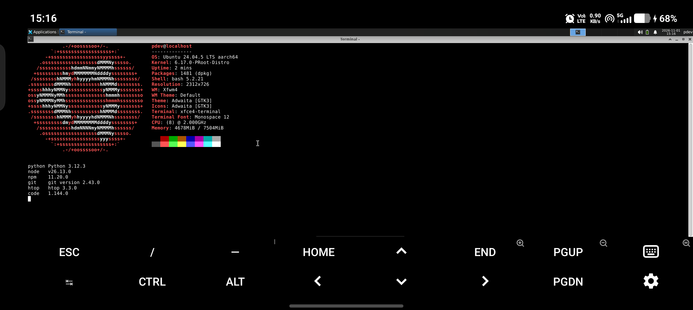

### Why an app does not open

| Symptom | Cause | Fix |
|---|---|---|
| VS Code, Chromium, or Antigravity do nothing at all | proot cannot provide a setuid sandbox; Electron aborts and the CLI still exits 0 | v1.7.1 writes `--no-sandbox` wrappers automatically. On an older install, run menu 12 |
| Firefox shows "The security sandbox is disabled" | the same limitation; Mozilla only warns | harmless; the browser works |
| Chromium shows "unsupported command-line flag: --no-sandbox" | Chromium warns about the flag the launcher must pass | harmless; dismiss the bar |
| The window opens mostly off-screen, with only a strip visible | a saved window position from a different screen size | delete that app's state, for example `rm -rf ~/.config/Code`, then reopen |
| The app vanishes when the terminal closes | GUI apps live inside the `start-linux` session | start them from the desktop menu, not from a one-off shell |
| `apt` says "requested operation requires superuser privilege" | you are in the user terminal | use the root terminal, or prefix the command with `sudo` |

If something still fails, collect the state and attach it to an issue:

```bash
./install_linux.sh --diagnostics     # ~/lfa-diagnostics-<date>.tar.gz, secrets removed
```

### Tested applications

Captured on a Vivo V2437 running Android 16 with Ubuntu 24.04, XFCE4, and
Termux:X11:

| VS Code 1.144 | Firefox |
|---|---|
| 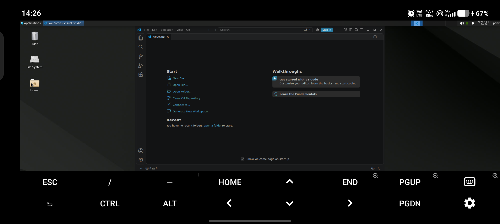 | 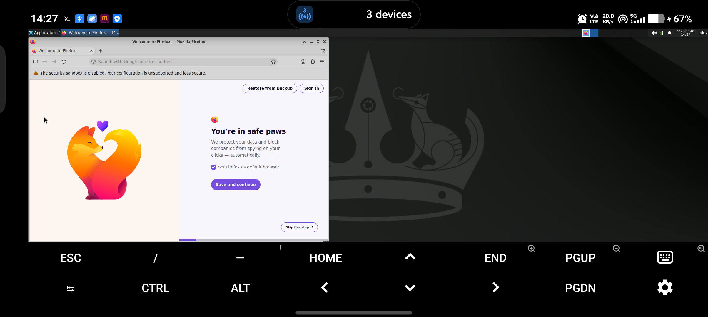 |

| Chromium | LibreOffice Writer 24.2 |
|---|---|
| 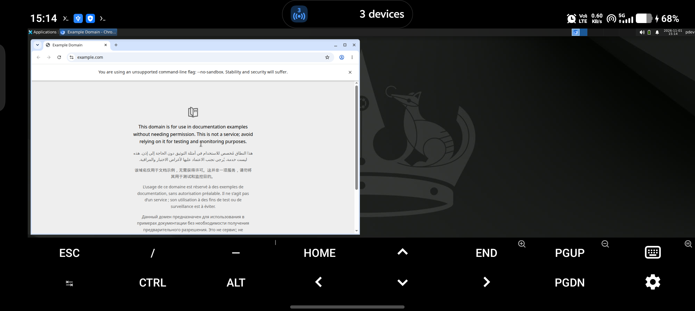 | 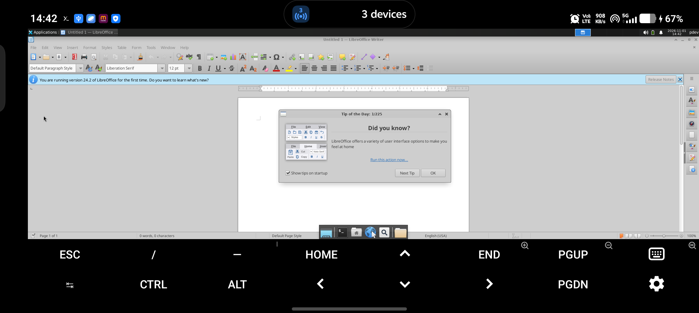 |

| GIMP | VLC |
|---|---|
| 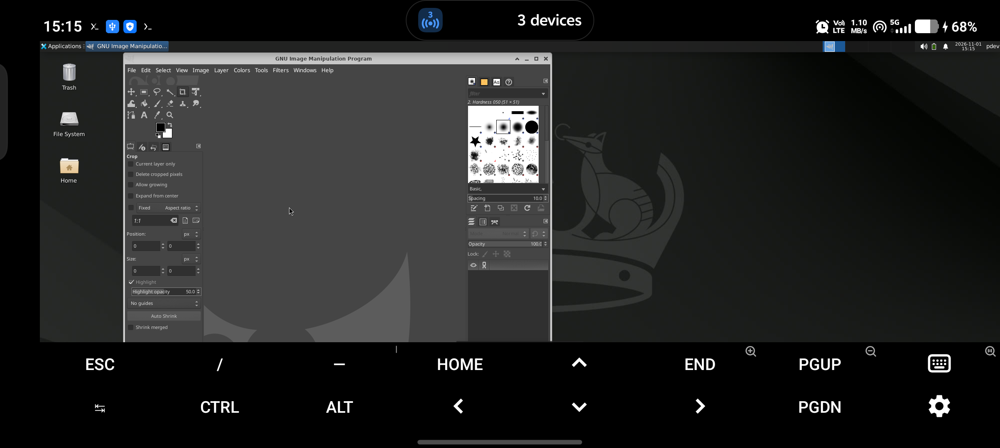 | 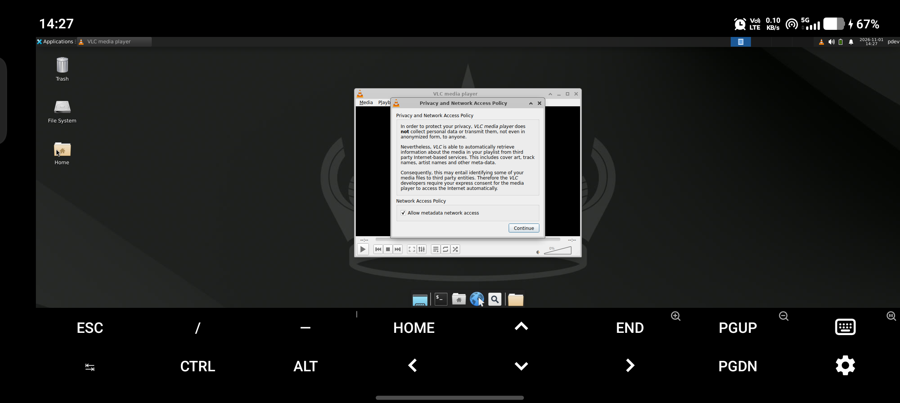 |

Antigravity IDE:

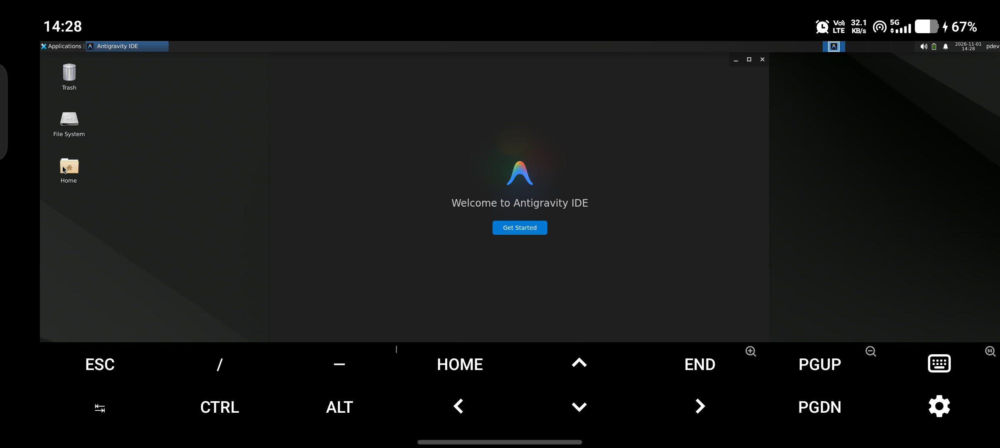

CLI tools verified in the same session: Python 3.12.3, Git 2.43.0,
Node 26.13.0, npm 11.20.0, curl 8.5.0, wget 1.21.4, neofetch 7.1.0, and htop
3.3.0.

## Software that cannot run

Some software needs kernel features, namespaces, device nodes, or a real
service manager, and no amount of userspace shimming can provide those. The
short list is:

- `systemd`, `snapd`, Flatpak and bubblewrap sandboxes
- Docker, Podman, LXC/LXD, libvirt, VirtualBox, QEMU/KVM, Waydroid
- WireGuard/OpenVPN/TUN/TAP, raw packet capture, iptables/nftables enforcement
- CUDA, ROCm, vendor GPU compute, hardware video encode/decode
- kernel modules, real `mount`/`chroot`/`unshare`, real root/SELinux control
- Bluetooth/BlueZ, NFC, camera as `/dev/video*`, sensors, USB host as device
  nodes
- Hyprland on a phone without a writable DRM render node, simultaneous X11 + VNC,
  foreign-architecture binaries

Full reasons, the “works with caveats” list, Android 5/6/7 differences, and
what Termux:API can actually expose are in
[docs/INCOMPATIBLE.md](docs/INCOMPATIBLE.md).

## Troubleshooting index

> Detailed guide: [docs/TROUBLESHOOTING.md](docs/TROUBLESHOOTING.md) covers
> evidence collection, the root cause of each failure, verification steps, the
> recovery ladder, and an error-string index. The entries below are the short
> version.

Jump to a symptom:

| Symptom | Entry |
|---|---|
| Termux randomly exits with signal 9 | [#1 Phantom process killer](#1-the-phantom-process-killer-termux-randomly-crashes) |
| `sudo` and `su` do not elevate | [#2 sudo](issues.md) |
| `apt` prints scary errors during install | [#3](#3-scary-apt-errors-during-installation) |
| `dpkg: requested operation requires superuser privilege` | [#4](#4-dpkg-error-requested-operation-requires-superuser-privilege) |
| `unknown system group 'messagebus' in statoverride` | [#5](#5-dpkg-unrecoverable-fatal-error--unknown-system-group-messagebus-in-statoverride-file) |
| "Cannot establish any listening sockets" | [#6](#6-cannot-establish-any-listening-sockets---make-sure-an-x-server-isnt-already-running) |
| Termux:X11 stays open after `stop-linux` | [#7](#7-termuxx11-app-stays-open-after-running-stop-linux) |
| VS Code or Chromium does not open | [Sandboxed apps](#17-sandboxed-apps-open-and-close-immediately) |
| `groups: cannot find name for group ID ...` | [#8](#8-groups-cannot-find-name-for-group-id-99909997-in-a-user-terminal) |
| Uninstall leaves a ghost distro | [#9](#9-uninstall-says-the-distro-is-gone-but-it-still-appears-or-is-incomplete) |
| Install seems frozen | [#10](#10-installation-seems-frozen-at-setting-up-elementary-xfce-icon-theme) |
| Black screen or "Unable to contact settings server" | [#11](#11-desktop-is-black-or-says-unable-to-contact-settings-server) |
| GTK crash, desktop vanishes | [#12](#12-gtk-crashes-with-gtkerror--bail-out-and-the-desktop-vanishes) |
| `snapd` fails to configure | [#13](#13-snapd-fails-to-configure-unable-to-set-cap_setfcap-effective-capability) |
| GNOME does not start | [#16](#16-gnome-experimental-does-not-start-or-the-desktop-is-broken) |
| Need to switch between X11 and VNC | [3.9 in the detailed guide](docs/TROUBLESHOOTING.md#39-how-do-i-switch-between-termuxx11-and-vnc) |

Everything else, including known bugs, limitations, and the deferred list, is
in [issues.md](issues.md).

### 1. The "Phantom Process Killer" (Termux randomly crashes)

Starting in Android 12, Android limits background child processes. A Linux
desktop needs many processes, so Android may kill Termux with
`[Process completed (signal 9)]`.

Fix for Android 14 and later:

1. Open Android Settings, then About phone, and tap Build number seven times.
2. Go to Settings, then System, then Developer options.
3. Turn on Disable child process restrictions and restart Termux.

For Android 12 or 13, search for "Termux ADB disable phantom process" to apply
the fix from a PC.

### 2. `sudo` / `su` fail inside the distro ("no new privileges", wrong ownership)

The real binaries can never work here, so every install ships a ritual-only
`sudo` shim. No real `sudo` package is installed.

- `sudo <cmd>` asks for the install-time password (`root`, three tries like the
  real thing), then runs the command with your current identity and passes
  through its exit status. Flags `-i` and `-s` for a shell, `-u` for yourself
  or root, `-v`, `-n`, `-p`, and `-E` behave sanely. Switching to any other
  account is refused with an explanation.
- Why? Android app processes carry the `NO_NEW_PRIVS` flag, and proot cannot
  grant real root, so `sudo` and `su` can never elevate inside proot on any
  device. This was verified: even nested re-execution fails because no host
  binary can link under the outer session. You already own every file, so
  elevation is unnecessary. The shim exists so muscle memory keeps working.

### 3. Scary `apt` errors during installation

While installing packages, you may see red errors such as:

- `Failed to scan devices: Permission denied`
- `Failed to write database /usr/lib/udev/hwdb.bin`
- `Failed to send reload request`

Ignore them. Linux packages try to communicate with physical hardware or the
`systemd` init process during installation. Since you are inside Android
without direct hardware or init access, these post-install hooks fail safely
and do not affect the desktop.

### 4. `dpkg: error: requested operation requires superuser privilege`

Symptom: plain `apt install` fails inside a user terminal while `apt update`
works.

Fix: `dpkg` refuses to run unless uid is 0, and the user shell runs as your
normal uid. Either use `sudo apt install`, since the shim emulates uid 0, or
reopen the distro as a root terminal with `start-linux` or `terminal-linux` and
install there. On Alpine this never happens because `apk` performs no uid
check.

### 5. `dpkg: unrecoverable fatal error ... unknown system group 'messagebus' in statoverride file`

Symptom: every `apt install` or `apt upgrade` aborts with this message, even as
root, while `apt update` still works.

Why: `/var/lib/dpkg/statoverride` contains a row naming a user or group that
does not exist in this guest. `dpkg` validates those rows on every run and
treats a missing group as fatal. Older versions of this installer pre-seeded
dbus's `messagebus` row before the group existed, for example on CLI-only
installs where dbus is never installed.

Easiest fix: update the manager with `git pull`, then run `./install_linux.sh`,
then 3) Manager, then 0) Repair a Distro. Use 12) Apply Latest Fixes for a full
migration of an older install. The Doctor prunes the bad rows, installs the
proot-safe shim, finishes half-configured packages, and audits the database. It
also runs automatically before every Update a Distro.

Manual one-liner inside the distro as root:

```bash
sed -i '/dbus-daemon-launch-helper/d' /var/lib/dpkg/statoverride
```

Then retry `apt install`. New installs cannot hit this. Setup installs a
proot-safe `dpkg-statoverride` shim that validates users and groups and
rewrites the file in place, and stale rows are pruned during setup and before
updates.

### 6. "Cannot establish any listening sockets - Make sure an X server isn't already running"

Symptom: you type `start-linux` and it immediately fails with this error.

Fix: the Termux:X11 display server is stuck running in the background from a
previous session. Run `stop-linux` to clean up the ghost processes, then run
`start-linux` again.

### 7. Termux:X11 app stays open after running `stop-linux`

This is normal. `stop-linux` shuts down the background Linux servers, but it
cannot force-close the Android app window because of Android's security
sandbox. Swipe the Termux:X11 app away in Recent Apps.

### 8. `groups: cannot find name for group ID 99909997` in a user terminal

Symptom: after `start-linux` and choosing the user terminal, the shell prints
this before the prompt.

Why: Android passes the app's supplementary groups into proot. Some of them,
especially the synthesized `99909997`, have no name in the distro's
`/etc/group`, so `groups` and `id` show a warning and the raw number. It is
cosmetic.

Fix inside the distro as root:

```bash
for g in $(id -G); do
  getent group "$g" >/dev/null 2>&1 || echo "android_$g:x:$g:" >> /etc/group
done
```

### 9. Uninstall says the distro is gone but it still appears or is "incomplete"

Why: an older uninstall could stop halfway if a login session was still
running or the rootfs was already damaged. That left a ghost container that
`proot-distro list` still showed.

Fix: update the manager with `git pull`, then run 3) Manager and 10) Uninstall
on that instance. It kills sessions, finishes the deletion, and removes legacy
`installed-rootfs` stubs. If it still cannot remove the directory, check
permissions under `$PREFIX/var/lib/proot-distro`.

### 10. Installation seems frozen at "Setting up elementary-xfce-icon-theme..."

Be patient. This package contains tens of thousands of tiny icon files. proot
translates every file operation through the phone's CPU, so unpacking thousands
of files takes much longer than on a native PC, sometimes 10 to 20 minutes on
mid-range phones. Keep Termux open and let it finish.

### 11. Desktop is black, or says "Unable to contact settings server"

Symptom: Termux:X11 opens, `start-linux` reports the desktop started, but you
only see a black screen or an XFCE error about the settings server. The session
log shows `dbus-update-activation-environment: unable to connect to D-Bus`.

Cause: two proot-specific problems. `dbus-launch` forks a daemon that dies
instantly under proot, and some images ship an empty `/etc/machine-id`, which
stops D-Bus from starting at all.

Fix: update to v1.5.6 or newer. On an existing install, run menu 12, then
`stop-linux` and `start-linux` again. The launchers now prefer
`dbus-run-session`, and the installer generates a machine-id.

### 12. GTK crashes with "Gtk:ERROR ... Bail out!" and the desktop vanishes

Symptom: the XFCE session starts and immediately dies.
`~/start-linux-session.log` shows `Gtk:ERROR:...ensure_surface_for_gicon:
assertion failed`, followed by `Bail out!` and a `bwrap` command line.

Cause: modern GTK on Kali 2026, Arch, Fedora 44, and Void decodes PNG and JPEG
through glycin, which sandboxes its loader with bubblewrap. proot cannot create
namespaces, so the loader fails and GTK aborts the application.

Fix: update to v1.5.6 or newer and run menu 12. The installer drops a
`/usr/local/bin/bwrap` shim that makes glycin fall back to in-process decoding,
and installs `glycin-loaders` where the distro splits them out. You should then
see `WARNING: Glycin running without sandbox.` in the session log.

### 13. `snapd` fails to configure: "unable to set CAP_SETFCAP effective capability"

Symptom: `apt` ends with `dpkg: error processing package snapd (--configure):
... returned error exit status 1`, and every later `apt` command stops on the
same package. This usually appears after installing `ubuntu-desktop` or an app
that pulls `snapd` in.

Cause: snap packages cannot work inside proot. `snapd`'s post-install script
needs `CAP_SETFCAP`, mount namespaces, and a running systemd, none of which
exist in a container without init. It will never configure successfully.

Fix: update to v1.5.8 or newer and run menu 0 (Repair a Distro / Doctor). It
purges a broken `snapd` and pins it off so apt stays usable. Manually:

```bash
sudo dpkg --purge --force-all snapd
sudo apt-get -f install
```

If you need `ubuntu-desktop`, note that it is only a metapackage. Removing
`snapd` does not remove the desktop you already installed.

### 14. `reboot` / `shutdown` say "System has not been booted with systemd" or "Failed to talk to init daemon"

Cause: a proot guest is a container, not a VM. There is no PID 1, so there is
nothing to reboot. Android owns the kernel.

Fix: leave the guest with `exit`, then from Termux use `stop-linux` to stop
everything or `start-linux` to restart the desktop. From v1.5.8, `reboot`,
`poweroff`, `halt`, and `shutdown` inside the guest print this guidance instead
of a systemd error.

### 15. Harmless proot warnings you can ignore

- `Detected unsafe path transition / (owned by pdev) to /dev (owned by root)`:
  systemd tooling in a package post-install walking into proot's bind-mounted
  `/dev`. Cosmetic.
- `Creating group 'kvm' with GID 993` or `render`: package post-installs adding
  groups. Harmless.
- `Failed to connect to bus: Host is down`: anything that expects a system
  D-Bus, such as system services, `systemctl`, or `service`, cannot work in
  proot. Use the manager menu or run services by hand.

### 16. GNOME (experimental) does not start, or the desktop is broken

Symptom: `start-linux` reports the desktop started, but the screen stays on the
X cursor, or GNOME starts with no dock or settings and crashes at random.

Cause: GNOME is experimental here. It runs `gnome-shell --x11` without
`gnome-session`, so the services the session normally provides, such as the
systemd user session, logind, portals, and the session manager, are absent.

Fix, in order:

1. Read `~/start-linux-session.log` inside the distro.
2. `A connection to the bus can't be made` or `LoginManagerSystemd` in the log
   means the private system bus is missing. Re-run menu 12 (Apply Latest Fixes)
   so the launcher is regenerated.
3. `Non UTF-8 locale (ANSI_X3.4-1968) is not supported!` or apps exiting with
   status 8 means the session has no UTF-8 locale. Use menu 12.
4. If it says the X11 session is not supported, your GNOME is 49 or newer. Use
   a release with GNOME 48 or older.
5. Switch to VNC if you were using Termux:X11. GNOME crashes far more often
   over X11.
6. Run menu 0 (Doctor), then `start-linux` again. Package upgrades can break
   the session.
7. If Settings crashes, the only known workaround is to wipe
   `~/.cache ~/.config ~/.local`. This also deletes your settings.
8. If it keeps misbehaving, reinstall with MATE (option 3). It has the same
   GNOME heritage, is stable, and needs no systemd.

### 17. Sandboxed apps open and close immediately

Symptom: VS Code, Chromium, or Antigravity "does not open". The command returns
silently, or the window flashes and disappears. Firefox starts but shows "The
security sandbox is disabled".

Why: Electron and Chromium need a setuid sandbox helper. proot cannot create
setuid binaries, so the zygote aborts. VS Code is the worst case: its CLI exits
with status 0 and prints nothing, so it looks like nothing happened.

Fix: v1.7.1 writes safe launchers automatically. On an older install, run
menu 12 (Apply Latest Fixes), or recreate them by hand:

```bash
sudo tee /usr/local/bin/code >/dev/null <<'EOF'
#!/bin/sh
exec /usr/share/code/code --no-sandbox --disable-gpu "$@"
EOF
sudo chmod 755 /usr/local/bin/code
```

Then make the menu entry use it:

```bash
sudo sed -i 's|^Exec=/usr/share/code/code |Exec=/usr/local/bin/code |' \
  /usr/share/applications/com.microsoft.VSCode.desktop
update-desktop-database /usr/share/applications 2>/dev/null || true
```

Chromium needs `--no-sandbox --disable-dev-shm-usage`. The menu 12 wrapper adds
both. This is a proot limitation, not a bug that can be fixed in the apps.

## Contributing

Contributions, issues, and feature requests are welcome. Read
[CONTRIBUTING.md](CONTRIBUTING.md) first. It covers the lint gate, the device
test procedure, and how to add a distro or desktop.

- Bug reports: use the issue form. It asks for version, device, distro, and
  logs.
- Security problems: use [SECURITY.md](SECURITY.md). Never a public issue.
- Design questions: `docs/DECISIONS.md` explains why real `sudo` and systemd are
  out of scope, and what a nested Wayland session can and cannot do.

### Running the test suite

`tests/test-all.sh` exercises the installer end to end with stubbed system
commands: entry modes, the install matrix for modern and legacy distros,
questionnaire validation, generated scripts, the sudo password ritual over a
real pty, and every manager-menu operation. It needs no network, no root, and
no real installs. It requires `bash`, `coreutils`, `timeout`, and `python3`,
plus `script` from util-linux for the pty test, which is skipped if absent:

```bash
chmod +x tests/test-all.sh
./tests/test-all.sh   # expect: PASS=677 FAIL=0
```

The suite is deliberately stubbed. It cannot prove a desktop actually appears.
The results on two physical devices are in
[docs/TEST-REPORT.md](docs/TEST-REPORT.md).

For the real Android layer, CI boots emulators and runs
`tests/termux-e2e.sh` over SSH. Pull requests run a six-scenario smoke matrix;
a reduced matrix runs weekly, and the full ~700-scenario matrix is a manual,
sharded run. See [docs/CI-ANDROID.md](docs/CI-ANDROID.md) for the architecture,
the pinned APKs, and the emulator-vs-device gaps.

## Credits

Linux-For-Android is created and maintained by
[pdev-labs](https://github.com/pdev-labs), a solo developer.

All original code, documentation, tests, screenshots, and release work in this
repository are by pdev-labs. Upstream projects are dependencies and are
credited below. See [AUTHORS.md](AUTHORS.md).

It builds on these upstream projects:

- [Termux](https://termux.dev/): the Android terminal and package environment
- [proot-distro](https://github.com/termux/proot-distro): the container manager
- [Termux:X11](https://github.com/termux/termux-x11): the X11 display server
- [TigerVNC](https://tigervnc.org/): the VNC server
- [VirGL](https://virglrenderer.github.io/): 3D acceleration
- The eight supported distributions and their package maintainers

## License

This project is licensed under the GNU General Public License v3.0 (GPL-3.0).
Any derivatives, forks, or modifications must also remain open source and be
distributed under the same license.
