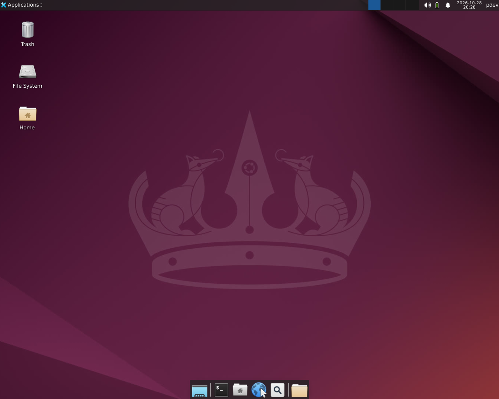
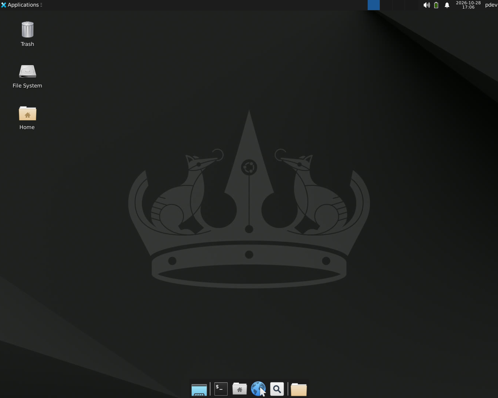
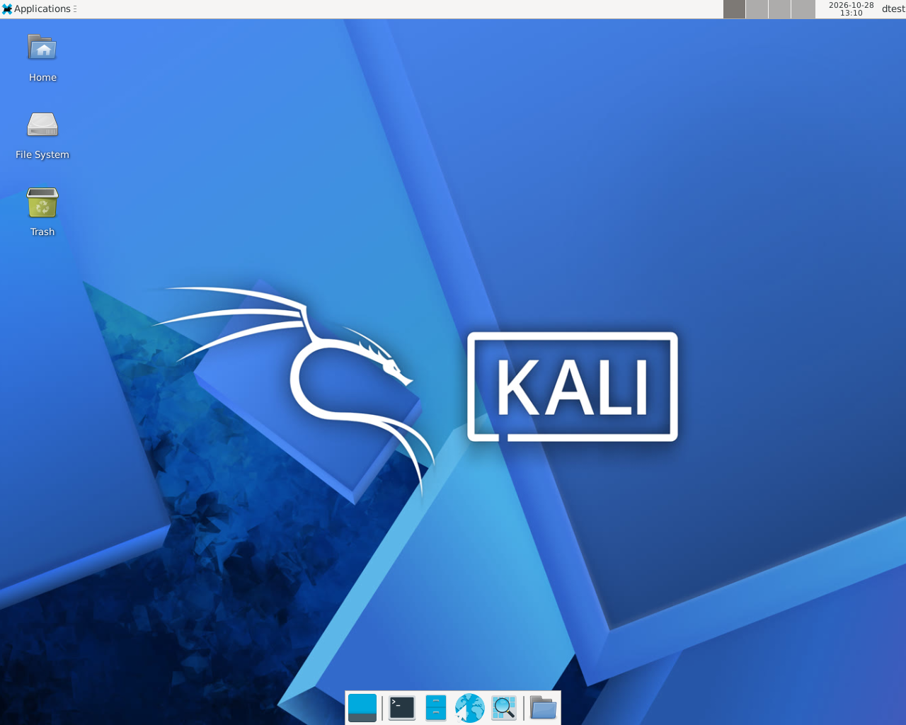
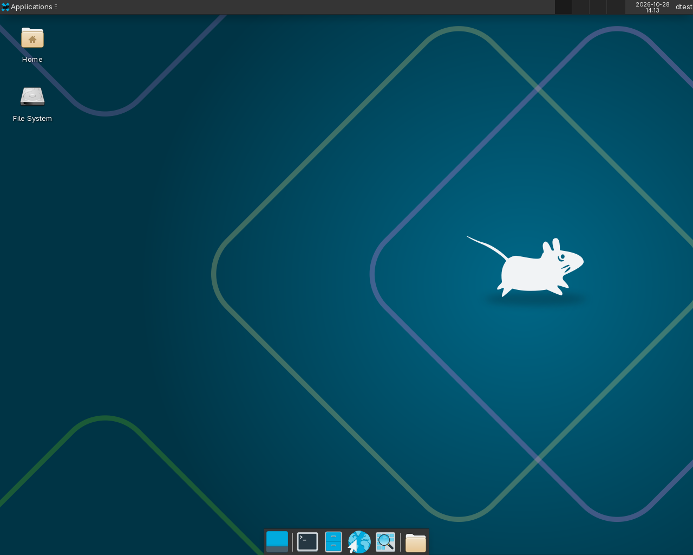
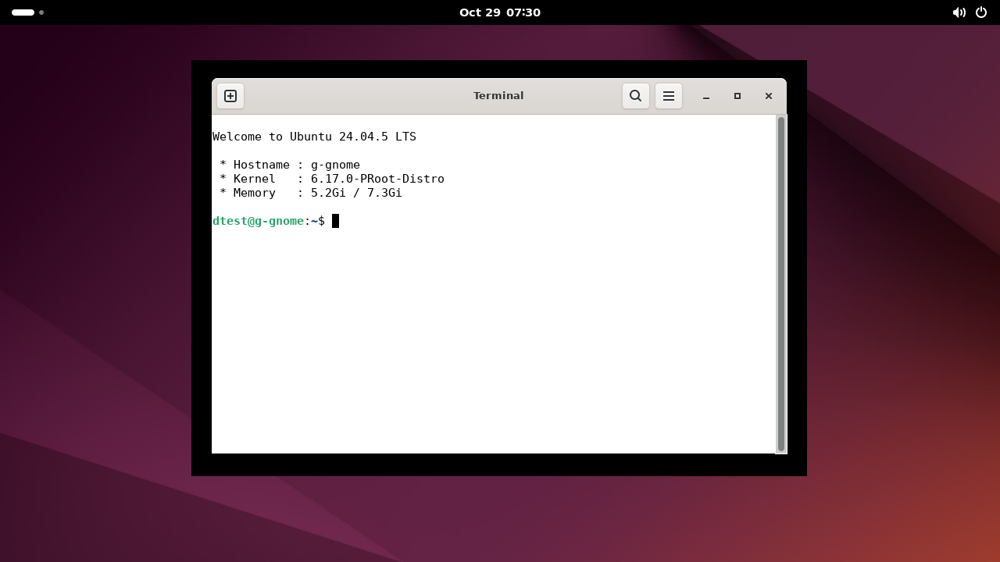
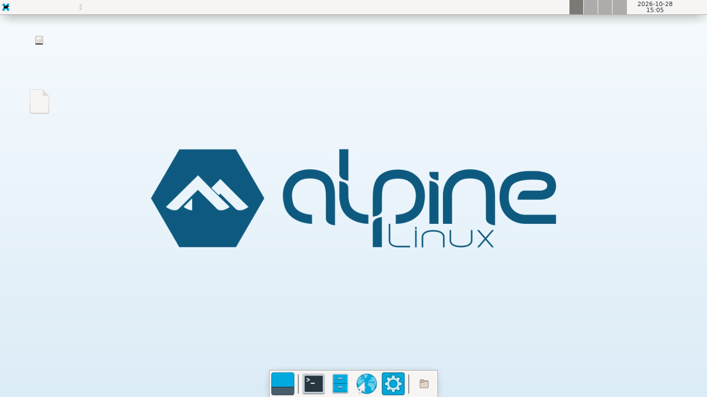
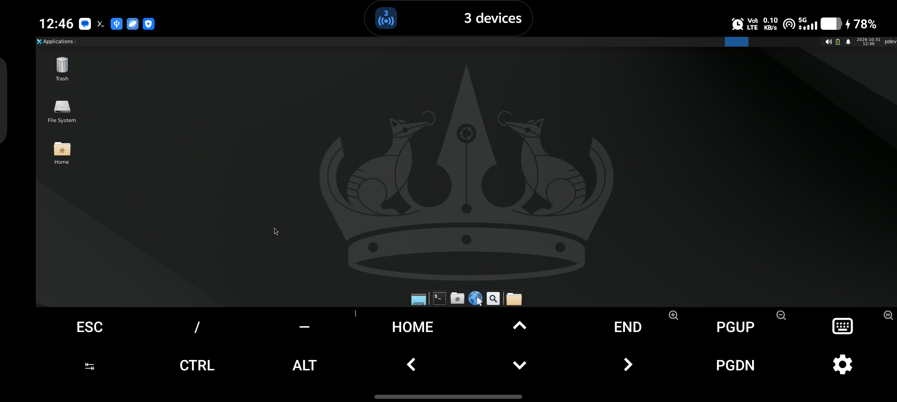

<div align="center">
  <h1>🐧 Linux for Android Manager</h1>
  <p><b>Run a real Linux desktop — Ubuntu, Debian, Kali, Arch, Fedora, openSUSE, Void or Alpine — on an Android phone.<br>One script, no root, verified on a 2016 phone and a 2026 phone.</b></p>
  <p>
    <a href="https://github.com/pdev-labs/Linux-For-Android/actions/workflows/ci.yml"></a>
    
    
    
    
  </p>
  
  <br>
  <sub>Ubuntu 24.04 · XFCE4 · Termux:X11 on a Vivo V2437 (Android 16)</sub>
</div>

> **Known limitations** are tracked in **[issues.md](issues.md)** — 54 findings
> with severity: 38 fixed, 11 partial and 5 deliberately deferred. Read it before
> installing anything experimental.

<hr>

## 📖 Table of Contents
- [Quick start](#-quick-start)
- [Screenshots](#-screenshots)
- [Verified on real hardware](#-verified-on-real-hardware)
- [Hard problems solved](#-hard-problems-solved)
- [GNOME (experimental)](#-gnome-experimental)
- [Key features](#-key-features)
- [First-run setup](#-first-run-setup)
- [Older devices (Android 5/6)](#-older-devices-android-56-eg-oppo-a37fw--verified-guide)
- [Usage guide](#-usage-guide)
- [Troubleshooting index](#-troubleshooting-index)
- [Architecture](docs/ARCHITECTURE.md) · [Design decisions](docs/DECISIONS.md) · [Changelog](CHANGELOG.md)
- [Known issues](issues.md) · [Contributing](CONTRIBUTING.md) · [Security](SECURITY.md)
- [License](#-license)

## ⚡ Quick start

```bash
# 1. Install Termux from F-Droid (never the Play Store build)
# 2. Then, in Termux:
pkg update -y && pkg install git -y
git clone --depth 1 --branch v1.7.0 https://github.com/pdev-labs/Linux-For-Android.git
cd Linux-For-Android && ./install_linux.sh
```

Pick **Guided setup**, choose a distro and desktop, answer a few questions, and
you get `start-linux` / `stop-linux` commands plus a home-screen shortcut.
Pin a different version by changing `--branch`; `main` is development.

Requirements: ~1 GB free (CLI), ~2.5 GB (desktop), 3.5 GB (GNOME); Android 5.1
or newer. The installer checks free space before it starts.

## 🖼 Screenshots

All captured on real devices, not mockups.

| Ubuntu 24.04 · XFCE | Ubuntu · dark mode |
|---|---|
|  |  |

| Kali Rolling | Arch Linux ARM |
|---|---|
|  |  |

| Alpine Linux | GNOME 46 (experimental) |
|---|---|
|  |  |

**Android 5.1.1 (2016 Oppo A37fw) running Alpine 3.18 — legacy mode, VNC:**



## 🌟 About the Project

Turning your Android device into a full-fledged Linux workstation has never been easier. **Linux for Android Manager** is a fully automated, interactive bash script that wraps around `proot-distro` to install, manage, backup, share, update, and configure highly customized graphical Linux environments directly on your smartphone or tablet.

Currently supported distributions:
- **Ubuntu** (apt)
- **Debian** (apt)
- **Kali Linux** (apt)
- **Arch Linux** (pacman)
- **Fedora** (dnf)
- **OpenSUSE** (zypper)
- **Void Linux** (xbps)
- **Alpine Linux** (apk, musl — recommended for Android 5/6, tiny & fast)

> **Android 5/6 devices (e.g. kernel 3.10):** the script auto-detects legacy
> devices, installs `proot-distro` v4.2.0 from source when the package is
> missing, forces VNC instead of Termux:X11, and skips VirGL. **Alpine**
> (musl) and **Debian** (auto-switches to bullseye, glibc 2.31) are verified
> working there — modern glibc distros (bookworm, Ubuntu mantic, Fedora
> 39, …) cannot execute on a 3.10 kernel.

## ✅ Verified on Real Hardware

Every distribution below was installed **and its desktop launched** on physical
hardware, not just simulated. Full details, root causes and evidence:
**[docs/TEST-REPORT.md](docs/TEST-REPORT.md)**.

| Device | Android | Kernel | Backend |
|---|---|---|---|
| Vivo V2437 | 16 (SDK 36) | 6.1.145 | Termux:X11 **and** VNC |
| Oppo A37fw | 5.1.1 (SDK 22) | 3.10 | VNC (legacy mode) |

| Distro | Install | Live desktop | Notes | Verified on |
|---|---|---|---|---|
| Ubuntu 24.04 | ✅ | ✅ | light and dark, clean first login | v1.7.0 |
| Kali Rolling | ✅ | ✅ | | v1.7.0 |
| Fedora 44 | ✅ | ✅ | | v1.7.0 |
| openSUSE Tumbleweed | ✅ | ✅ | first login shows a PulseAudio panel warning | v1.7.0 |
| Arch Linux ARM | ✅ | ✅ | | v1.7.0 |
| Void Linux | ✅ | ⚠️ | X11 fine; panel inconsistent over VNC | v1.7.0 |
| Alpine Linux (edge) | ✅ | ⚠️ | desktop and wallpaper render; `xfce4-panel` does not start | v1.7.0 |
| Alpine 3.18 (Android 5) | ✅ | ✅ | legacy VNC desktop, panel works | v1.7.0 |
| Ubuntu GNOME 46 (experimental) | ✅ | ✅ | shell and apps run; session services missing | v1.7.0 |

> Test suite: `343` checks, `0` failures — the same suite is what runs on the
> devices (`tests/device-matrix.sh`). The table above is **as of v1.7.0**; a
> row is only marked verified after a real install on the device named above.

Fresh v1.7.0 capture — Ubuntu 24.04 · XFCE4 · Termux:X11 on the Vivo V2437
(Android 16), 2026-10-31, with the suite and `--diagnostics` verified in the
same session:



### Measured on hardware

| Measurement | Value |
|---|---|
| Alpine 3.18 + XFCE + VNC on the Oppo A37fw (2016) | **3m 32s**, 204 MB |
| Ubuntu 24.04 + GNOME 46 on the Vivo V2437 | **27m 45s**, ~2.5 GB |
| Desktop cold start (XFCE, X11 on the Vivo) | ~10 s after `start-linux` |
| GNOME over software rendering | ~1–7 FPS video playback, usable shell |

## 🧩 Hard problems solved

These are the failures that made the project what it is. Each one was found on
a device, root-caused, and fixed — the notes are in `docs/TEST-REPORT.md`.

- **GNOME died before its first frame.** `gnome-shell` asks logind for
  suspend/lock state over the *system* bus, which proot does not have, so
  `Gio.DBus.system` threw and the shell aborted. Fix: point
  `DBUS_SYSTEM_BUS_ADDRESS` at a private daemon with no logind, so the lookup
  fails softly.
- **Every GTK app exited with status 8.** proot starts sessions with an empty
  `LANG`; glib reports it as ASCII, and GTK refuses to start. Fix: `C.UTF-8`
  plus `dbus-update-activation-environment --all`, which `gnome-session`
  normally does.
- **`snapd` permanently broke `apt`.** Ubuntu's snap packages cannot run in
  proot (no `CAP_SETFCAP`, no mounts, no systemd), and a half-configured
  `snapd` wedged dpkg. Fix: Doctor purges it and pins it out with an APT
  preference file.
- **VNC refused to start after an X11 session** with *"display :1 is taken"*.
  Fix: release the socket and lock, but only when no process whose argv[0] is a
  real X server holds `:1` — `pgrep -f` alone matches the launcher's own
  command line.
- **Android 5.1 could not run Debian 12 at all.** Modern glibc aborts on the
  3.10 kernel at the first guest command. Fix: auto-switch to Debian bullseye
  (glibc 2.31) or Alpine (musl), and prove it on a 2016 phone.
- **TigerVNC ≥ 1.15 killed the session** when the xstartup returned. Fix: a
  foreground `exec` session plus a proot keepalive, because
  `proot --kill-on-exit` reaps the server otherwise.

## 🧪 GNOME (Experimental)

> **Status: BETA / EXPERIMENTAL. It is not a supported desktop. Expect crashes
> and missing features. Do not use it for anything you depend on.**

> **Hardware validation:** GNOME Shell **does** start and render on the Vivo
> (Android 16, Ubuntu 24.04, GNOME 46) over both Termux:X11 and VNC, and
> `gnome-terminal` runs inside it. It is still beta: the session services
> below are missing, and the first login opens with the overview.

Guided setup offers **GNOME (experimental)** as option 5, but only on
Ubuntu, Debian, Kali, Arch Linux, Fedora and openSUSE, and only on Android 8+.
It is hidden on Android 5/6, Alpine and Void, where it cannot be installed.

### Why it is experimental

A normal GNOME session starts `gnome-session`, which requires **systemd** and
**logind** — neither exists inside proot. This option works around that by
skipping `gnome-session` and launching `gnome-shell --x11` directly inside a
D-Bus session.

The shell itself runs. The session services that `gnome-session` normally
starts do not, which is where the breakage comes from.

Two proot-specific patches make it start at all:

1. **A private system bus.** GNOME Shell asks logind for suspend/lock state
   while building the background. proot has a session bus but no system bus,
   so `Gio.DBus.system` throws `A connection to the bus can't be made` and the
   shell dies before the first frame. The launcher points
   `DBUS_SYSTEM_BUS_ADDRESS` at a private daemon that simply has no logind.
2. **A UTF-8 locale.** proot starts the session with an empty `LANG`, which
   glib reports as `ANSI_X3.4-1968`. GTK apps then refuse to start
   (`Non UTF-8 locale ... is not supported!`, `gnome-terminal` exits with
   status 8). The launcher sets `LANG=C.UTF-8` and publishes the environment
   with `dbus-update-activation-environment --all`, which `gnome-session`
   would normally do.

### What is missing or broken

- Login/logout menu, session saving, session restore
- Screen locking, idle blanking, suspend/inhibit
- Some panel/dock entries and the app grid on first login
- **GNOME Settings (`gnome-control-center`) may crash**, especially the Sound
  panel. The usual workaround wipes `~/.cache ~/.config ~/.local`, which also
  wipes your settings.
- Portals, auto-mount, polkit prompts, UPower/brightness, notifications:
  partial or absent
- Extensions that need root or Android files do not work
- Touch input often only works in mouse mode
- Video playback around **1–7 FPS** (software rendering)
- **Termux:X11 crashes the session often.** VNC is pre-selected and is much
  more stable for GNOME.
- A package upgrade that updates systemd/gdm can break the session. If that
  happens, run menu **0 (Doctor)**, then `start-linux` again.
- GNOME 49+ removed the X11 session. The launcher detects this and refuses
  with a clear message instead of showing a black screen; use a release with
  GNOME 48 or older.
- Cosmetic: under software rendering the window shadow is drawn as a solid
  black rectangle, and the first login opens in the overview instead of the
  desktop.

### Requirements

- Android 8 or newer (no Android 5/6)
- **3 GB RAM minimum, 4 GB+ recommended** — it is heavy
- around **2.5–3 GB** of free storage
- Ubuntu, Debian, Kali, Arch, Fedora or openSUSE (not Alpine, not Void)

### The warning is not optional

Selecting it prints the full warning and requires an explicit **Yes**. Decline
and the installer falls back to XFCE4. Bug reports for GNOME are accepted as
experimental only.

> If you want a stable GNOME-family desktop today, use **MATE** (option 3):
> same GTK/GNOME 2 heritage, no systemd or compositor requirements, and it is
> covered by the test suite and the verified matrix above.

## 🚀 Key Features

### The Ultimate Experience
- **Root or User Terminal, Your Choice:** `start-linux` (and the standalone
  `terminal-linux` shortcut) ask every boot whether you want a **root**
  terminal (full admin) or the **`user`** terminal — with no display/audio
  servers started in terminal modes.
- **Feels like a real Linux box:** Ubuntu-style colored prompt with your chosen hostname, a proper login banner, a `hostname` command that reports that name, colorised `ls`/`grep`, and Termux/Android variables stripped from `env`. No proot caveats or "use the root terminal" notices in the guest.
- **Authentic distro wallpaper, light or dark:** every GUI install automatically gets the selected distribution's real default wallpaper — Ubuntu 24.04, Debian 13, Kali 2026, Fedora 44 and openSUSE Tumbleweed images, Arch's official `archlinux-wallpaper` wave pair, and official Void/Alpine artwork. Guided setup asks whether you want the **light or dark** variant. The chosen image is bundled (no download at install time), staged into the guest, and applied on desktop login through an XDG autostart entry. **CLI-only installs skip wallpaper setup entirely.**
- **Honest Privileges (Ritual `sudo`):** Real setuid elevation is impossible
  inside proot on Android, so instead of a broken `sudo` you get a small
  ritual-only shim: it asks for the install password, then runs your command
  with the full access you already have. No silent failures, no surprises.
- **Interactive, npm-style UI:** arrow-key menus with descriptions, Enter to choose, space to toggle multiple packages, y/n confirmations and coloured status screens. You can also type an option number (e.g. `10`). When stdin is piped (CI or `curl | bash`), every menu falls back to plain numbered prompts so automation never hangs.
- **Software that actually installs:** the built-in software menu maps each choice to the right package for the distro — APT, DNF, Zypper, XBPS, Pacman and APK — including `python3-pip`/`py3-pip`, real Firefox, Chromium, LibreOffice, GIMP, VLC, VS Code, Node/npm and Google Antigravity IDE.
- **Snap-free browsers on Ubuntu 24.04+:** Ubuntu’s snap-only Firefox and Chromium cannot run in proot, so the manager installs the official Mozilla ARM64 Firefox tarball and Debian bookworm’s Chromium, with an APT pin that keeps them from being replaced by snap stubs.
- **Real Google Antigravity IDE:** installs the official ARM64 build into `/opt/antigravity-ide` and launches it with the dbus/GPU flags needed inside proot — no placeholder “terminal edition”.
- **Persistent Chromium GPU toggle:** the managed `/etc/lfa-chromium-flags` file lets the acceleration menu add/remove VirGL flags without ever overwriting the proot-safe Chromium wrapper.
- **Robust uninstaller:** shows the instance, distro/desktop, rootfs path and size; asks for confirmation; stops active sessions first; verifies removal and cleans up half-deleted containers or legacy ghost entries left by older versions.
- **proot-distro v3 / v4 / v5 aware:** reads the real rootfs from `installed-rootfs/` (older) or `containers/<name>/rootfs` (v4+), and understands v5's OCI image installs (`alpine:latest`, etc.) plus its `restore FILE` interface. Doctor, migration, backup/restore and the launchers work on all layouts.
- **Legacy Android Auto-Support:** Android 5/6 devices are detected and get
  proot-distro v4.2.0 from source, forced VNC, Alpine + Debian-bullseye
  options, and workarounds for old `proot` — all automatically.
- **VirGL 3D Hardware Acceleration:** Automatically configures `virglrenderer-android`, passing 3D OpenGL rendering directly to your phone's physical GPU for incredibly smooth graphics.
- **Hardware Acceleration (Termux:X11):** Choose between traditional VNC (software rendering) or Termux:X11 for a much smoother, hardware-accelerated desktop experience.
- **VNC that survives proot:** modern TigerVNC config, an `exec`-style desktop session, and a persistent proot keepalive (so `--kill-on-exit` cannot kill the server). `stop-linux` cleans up the server and its PID file, and `vncpasswd -f` accepts the default short passwords.
- **Fail-safe installs:** repository and package operations retry, and the installer refuses to print “Installation complete” when the chosen desktop or VNC components are missing.
- **Dynamic Display Settings:** Dynamically pick your screen resolution and UI scaling (Auto, 720p, 1080p, or Tablet size) to perfectly fit your device.

### Reliability & Security
- **Free-space preflight:** the installer refuses to start a 2.5–3.5 GB
  install on a device that cannot hold it, instead of dying halfway through
  `apt` and leaving a half-configured rootfs.
- **Secrets are transient:** the generated guest script holds the install
  passwords in a mode-`0600` file that is deleted after use *and* on Ctrl-C.
- **Hashed sudo ritual:** the shim stores a salted SHA-256 hash, never the
  password, and is mode `0700`.
- **Verified downloads:** the Microsoft signing key is checked by fingerprint
  before the VS Code repository is added; scraped download URLs are restricted
  to the vendor's own hosts; the legacy `proot-distro` tree is validated.
- **Stale-PID protection:** pidfiles are matched against the process command
  line before anything is killed, so a recycled PID cannot hit an unrelated
  process.
- **Pipefail:** a failure anywhere in a pipeline fails the step — this alone
  caught two real bugs in the dashboard.
- **Update notice:** a cached, 3-second, non-blocking check tells you when a
  newer release exists (`LFA_NO_UPDATE_CHECK=1` disables it).

### Automation & Management
- **1-Click Universal Updater:** Never manually type update commands again! The Manager Menu automatically detects your distro and updates it in the background.
- **Doctor / Repair (menu → 0):** One key fixes the usual proot breakages inside an existing distro — sanitises `dpkg`'s `statoverride`, reinstalls the proot-safe `dpkg-statoverride` shim, re-applies apt hardening, finishes half-configured packages with `dpkg --configure -a`, and audits the package database. Safe to run any time.
- **Apply Latest Fixes (menu → 12):** Bring a distro installed by an older Linux-for-Android up to date without reinstalling. It runs the Doctor, adds new config keys (`USER_NAME`, `COLOR_MODE`, `TIMEZONE`, `HOSTNAME`, `NEED_VIRGL`), bakes the hostname into the shell prompt, refreshes the VNC `xstartup`, re-applies the saved light/dark wallpaper for GUI instances, regenerates `start-linux` / `terminal-linux` / `stop-linux` from the current templates, updates the legacy bullseye plugin, rebuilds `libuid0` if missing, and repairs EOL apt sources.
- **System Dashboard:** Instantly view your Android phone's RAM availability, Termux storage consumption, and CPU architecture right from the manager menu.
- **Advanced Audio Fixer:** A built-in debugger that dynamically restarts PulseAudio and forcefully binds it to TCP protocols to instantly resolve any audio crackling issues.
- **Hardware Accelerated Web Browsing:** Easily optimize Chromium directly from the menu to force hardware-accelerated video decoding (`--enable-gpu-rasterization`, `--use-gl=egl`), giving you silky smooth YouTube playback over VirGL.
- **Instant SSH Server:** Start a native SSH server on port 8022 directly from the menu, allowing you to seamlessly remote into your phone from your PC.

### Portability & Convenience
- **Portable Export & Import (Share with Friends!):** Export your fully customized Linux OS as a `.tar.gz` file into your Android `Downloads` folder. Your friends can place the file in their `Downloads` folder and use the "Import" button to instantly clone your exact setup!
- **Home-Screen Widgets:** If you use the `Termux:Widget` app, the script automatically generates shortcuts so you can launch your Linux desktop (`Start-Linux`) or a plain shell (`Terminal-Linux`) with one tap straight from your Android home screen!

## ⚙️ Installation

### Prerequisites
1. Download and install [Termux](https://f-droid.org/en/packages/com.termux/) from **F-Droid**. 
   > ⚠️ **Warning:** Do NOT use the Google Play Store version of Termux, as it is outdated and severely broken.

### Install a release (recommended)

Pin the version you install. `main` is development and may be mid-change.

```bash
pkg update -y && pkg install git -y
git clone --depth 1 --branch v1.7.0 \
  https://github.com/pdev-labs/Linux-For-Android.git
cd Linux-For-Android
chmod +x install_linux.sh
./install_linux.sh
```

### Command line

```text
-h, --help       show usage and exit
-V, --version    print the version
    --list       list installed distributions
    --doctor     repair the selected distribution
    --yes        quick setup, all defaults, no menus
    --debug      keep the generated guest script for inspection
```

`--help` and `--version` work outside Termux too. Everything else still has
its interactive path in the menu.

## 🧭 First-Run Setup

On a real terminal, move with **↑/↓** and press **Enter**; shortcuts are shown at the bottom of every screen:

| Key | Action |
| --- | --- |
| `↑` / `↓` | move the highlight |
| `Enter` | select the highlighted item |
| `1`…`14` | type a number, then `Enter` (multi-digit works) |
| `Space` | toggle a package in the multi-select screen |
| `a` / `n` | select all / none (multi-select) |
| `q` | go back one screen |
| `y` / `n` | answer a confirmation |

Colours turn off automatically with `NO_COLOR=1` or when output is not a terminal. The first screen offers a few doors:

- **Quick setup** — every default, no questions. Picks Alpine on Android 5/6
  (Debian elsewhere), CLI-only on small/old phones, `user` / `root` / `root`
  credentials, device timezone, `localhost`.
- **Guided setup** — walks through distro (with a recommendation for your
  device), desktop (XFCE4 / LXDE / MATE / CLI, plus experimental GNOME on
  supported distros), **light/dark wallpaper mode**, display server, hardware
  acceleration, resolution, software, instance name, username, user + root
  passwords (typed blind), timezone, hostname, prompt style, autostart,
  storage, SSH, and widget — then shows a summary (passwords masked) and
  installs without asking twice.
- **Manager menu** — Install, update, repair (Doctor), backup, restore, export/import, SSH, browser acceleration, migration and uninstall, all in the same arrow-key UI.

Answers are saved to `~/.config/linux-for-android/setup.conf` (`0600`,
passwords base64-encoded, never plaintext). If the file exists you get a
fourth option, **Re-install with saved answers**, for one-command rebuilds;
a corrupt file falls back to guided setup instead of crashing.

## 📱 Older Devices (Android 5/6, e.g. Oppo A37fw) — Verified Guide

This configuration was tested end-to-end on Android 5.1.1 (kernel 3.10, aarch64).

### 1. Install the right Termux
- Current Termux requires Android 7+. On Android 5/6 install **Termux 0.118**
  (last build with Android 5 support) from the **F-Droid archive** — not the
  Play Store, not the latest F-Droid build.
- If packages 404, run `termux-change-repo` and pick a working mirror.

### 2. What the script handles automatically
- Detects legacy devices (`LEGACY MODE` banner) and installs **proot-distro
  v4.2.0** from source when the package is missing or broken.
- Forces **VNC** (Termux:X11 needs Android 8+, VirGL is unavailable).
- Skips GPU/audio backends gracefully when their packages don't exist.

### 3. Recommended choices in the wizard
- **Distro:** Alpine (option 8, musl — tiny, ~35 MB) or Debian, which
  auto-switches to **bullseye** on legacy devices. Do NOT pick Ubuntu,
  Fedora, Kali, Arch or Void here: their modern glibc cannot execute on a
  3.10 kernel (verified: instant failure at the first guest command), and
  Kali has no legacy plugin at all.
- **Desktop:** `None (CLI only)` for 1–2 GB RAM phones; XFCE + VNC is now
  verified working there too (**3m32s, 204 MB** for Alpine 3.18) if you have
  headroom. You need a VNC Viewer app on the phone.
- **Software selector:** keep it light (`git`, `htop`…). Skip browsers and
  LibreOffice on old phones.
- Keep **~1 GB free** before installing; CLI systems are small (Alpine
  ~35 MB, Debian ~150 MB plus package cache).

> On legacy devices the installer pins Alpine to the **v3.18** branch. The
> proot-distro image ships *edge* repositories, and edge glib/GTK abort on the
> 3.10 kernel (`ENOSYS: Function not implemented`), which kills the desktop.

### 4. Day-to-day notes
- `start-linux` / `terminal-linux` always ask: **root** or **user** terminal.
  Root is the default; pick user when you want the restricted-feeling shell.
- Install packages with `apk add` (Alpine), `apt install` as root, or
  `sudo apt install` from a user shell (the shim emulates uid 0) — never
  `su`. Plain `apt install` without `sudo` fails in user shells because
  `dpkg` demands uid 0; on Alpine even that works (`apk` performs no uid
  check). From EITHER terminal you CAN: edit any file, configure services.
  You CANNOT anywhere in proot: `su` or user
  switching (kernel `NO_NEW_PRIVS` flag — setuid can never work), `ping` /
  raw sockets, `mount`. The user shell is not restricted: it owns every
  file, so elevation is simply unnecessary.
- On Debian bullseye the installer already points `bullseye-security` at
  `archive.debian.org` (the suite is EOL and pruned from the main mirror).
- `fastfetch` does not exist in bullseye — use `neofetch`.
- **Sharing root-installed tools with `user`:** both accounts are the same
  owner underneath, so nothing is ever permission-blocked — tools are only
  *invisible* when they live under `/root`. Link any binary you need into
  the shared `/usr/local/bin` (on everyone's `PATH`):
  ```bash
  ln -sf /root/.opencode/bin/opencode /usr/local/bin/
  ```
  Per-user configs stay separate (`~/.config`, `~/.local/share`), so each
  account keeps its own setup while running the same binaries.
- Ignore `apt`/`dpkg` warnings about hardware, `systemd`, or `dbus` hooks
  failing — post-install hooks can't reach real hardware from proot and fail
  safely. Fresh installs ship a proot-safe `dpkg-statoverride` shim (rewrites
  the file in place, never records a missing user/group) plus a `policy-rc.d`,
  so dbus configures cleanly instead of ending half-done or breaking apt.

## 💻 Usage Guide

When you run `./install_linux.sh`, it will launch the interactive Manager Menu where you can Install, Update, SSH, view the Dashboard, Export, Import, Backup, Restore, or Uninstall any supported distribution.

Two maintenance options keep old installs healthy without reinstalling:

- **0) Repair a Distro** — Doctor for broken `dpkg`/`apt`, half-configured packages and stale `statoverride` rows. Safe any time, and also runs automatically before every distro update.
- **12) Apply Latest Fixes** — migration for a distro created by an older version of this script: refreshes launchers/`xstartup`, re-applies the saved light/dark wallpaper (GUI only), adds new config keys, fixes the hostname prompt, updates the legacy plugin, and rebuilds the uid0 helper if needed.

### Starting your Linux Desktop
Once installed, you never need to run the setup script again. Just type this anywhere in Termux:
```bash
start-linux
```
*(If you installed multiple OSs, it will automatically pop up a menu asking which one you want to boot!)*
If the install has a GUI, `start-linux` asks what you want: full desktop,
**root terminal only**, or **user terminal only** (no display/audio servers
started in terminal modes). CLI-only installs ask root vs user terminal.
Terminal choices default to root when you just press Enter (script-safe).

### Quick terminal without servers
```bash
terminal-linux
```
Opens a shell in a distro without touching PulseAudio, VirGL, or the
display server, then lets you pick the **root** or **user** terminal.
Handy for quick admin work and as a Termux:Widget shortcut (auto-created).

### Default Credentials & Privileges
- **GUI sessions run as:** `user` (VNC password: `root`)
- **`start-linux` / `terminal-linux` ask every time:** **root** terminal
  (default, full admin) or **user** terminal. Install packages directly
  (`apk add` on Alpine, `apt install` on Debian/Ubuntu, …).
- **`sudo` is a ritual-plus-emulation shim** (`/usr/local/bin/sudo`, password
  `root`): it asks for the password, then runs your command — preloading a
  tiny `libuid0` (built during setup, fakeroot-style, no daemon) that answers
  identity queries as uid 0 and neutralises `chown`/`setuid`/`setgroups`, so
  `sudo apt install` works even from a user shell. Setup also tells apt to
  skip its sandbox user (privilege dropping is impossible in proot). Real
  setuid elevation remains impossible inside proot — and unnecessary, since
  you already own every file.
- **Why no sudo?** Android app processes carry the `NO_NEW_PRIVS` flag and
  proot cannot grant real root, so `sudo`/`su` can never work inside proot
  on any device. You already own every file, so elevation is unnecessary.
  (On Alpine the manager is `apk`, not `apt` — bare `apt` would resolve to
  Termux's host copy and fail to link.)

### Stopping your Linux Desktop
To safely kill the desktop, display servers, and audio systems, type:
```bash
stop-linux
```

## 🛠️ Troubleshooting index

Jump to a symptom:

| Symptom | Entry |
|---|---|
| Termux randomly exits with signal 9 | [#1 Phantom process killer](#1-the-phantom-process-killer-termux-randomly-crashes) |
| `sudo`/`su` do not elevate | [#2 sudo](issues.md) |
| `apt` prints scary errors during install | [#3](#3-scary-apt-errors-during-installation) |
| `dpkg: requested operation requires superuser privilege` | [#4](#4-dpkg-error-requested-operation-requires-superuser-privilege) |
| `unknown system group 'messagebus' in statoverride` | [#5](#5-dpkg-unrecoverable-fatal-error--unknown-system-group-messagebus-in-statoverride-file) |
| "Cannot establish any listening sockets" | [#6](#6-cannot-establish-any-listening-sockets---make-sure-an-x-server-isnt-already-running) |
| Termux:X11 stays open after `stop-linux` | [#7](#7-termuxx11-app-stays-open-after-running-stop-linux) |
| `groups: cannot find name for group ID ...` | [#8](#8-groups-cannot-find-name-for-group-id-99909997-in-a-user-terminal) |
| Uninstall leaves a ghost distro | [#9](#9-uninstall-says-the-distro-is-gone-but-it-still-appears--incomplete) |
| Install seems frozen | [#10](#10-installation-seems-frozen-at-setting-up-elementary-xfce-icon-theme) |
| Black screen / "Unable to contact settings server" | [#11](#11-desktop-is-black-or-says-unable-to-contact-settings-server) |
| GTK crash, desktop vanishes | [#12](#12-gtk-crashes-with-gtkerror--bail-out-and-the-desktop-vanishes) |
| `snapd` fails to configure | [#13](#13-snapd-fails-to-configure-unable-to-set-cap_setfcap-effective-capability) |
| GNOME does not start | [#16](#16-gnome-experimental-does-not-start-or-the-desktop-is-broken) |

Everything else — known bugs, limitations and the deferred list — is in
**[issues.md](issues.md)**.

### 1. The "Phantom Process Killer" (Termux randomly crashes)

### 1. The "Phantom Process Killer" (Termux randomly crashes)
Starting in Android 12, Android limits background child processes. Since a Linux desktop requires many processes, Android may suddenly kill Termux (`[Process completed (signal 9)]`).
**Fix (Android 14+):**
1. Open Android **Settings** > **About phone** > tap **Build number** 7 times.
2. Go to **Settings** > **System** > **Developer options**.
3. Toggle **Disable child process restrictions** to **ON** and restart Termux.
*(For Android 12/13, search online for "Termux ADB disable phantom process" to apply the fix via a PC).*

### 2. `sudo` / `su` fail inside the distro ("no new privileges", wrong ownership)
The real binaries can never work here, so every install now ships a
**ritual-only `sudo` shim** instead (no real `sudo` package is installed):
- `sudo <cmd>` asks for the install-time password (`root`, 3 tries like
  the real thing) and then runs the command with your current identity,
  passing through its exit status. Flags `-i`/`-s` (shell), `-u` (only
  yourself/root), `-v`, `-n`, `-p`, `-E` behave sanely; switching to any
  other account is refused with an explanation.
- **Why?** Android app processes carry the `NO_NEW_PRIVS` flag and proot
  cannot grant real root, so `sudo`/`su` can never elevate inside proot on
  any device (verified: even nested re-execution fails, since no host
  binary can link under the outer session). You already own every file, so
  elevation is unnecessary — the shim exists so muscle memory keeps working.

### 3. Scary `apt` errors during installation
While installing packages, you might see red errors like:
- `Failed to scan devices: Permission denied`
- `Failed to write database /usr/lib/udev/hwdb.bin`
- `Failed to send reload request`
**Fix:** Ignore them! These are completely normal. Linux packages try to communicate with physical hardware or the `systemd` init process during installation. Since you are safely contained on Android without direct hardware/init access, these post-installation hooks fail safely without affecting your desktop.

### 4. `dpkg: error: requested operation requires superuser privilege`
**Symptom:** plain `apt install` fails inside a *user* terminal while `apt
update` works.
**Fix:** This is `dpkg` itself, which refuses to run unless uid is 0 — and
the user shell runs as your normal uid. Either use `sudo apt install` (the
shim emulates uid 0) or re-open the distro as a **root** terminal
(`start-linux` / `terminal-linux` → root) and install there. (On Alpine
this never happens: `apk` performs no uid check.)

### 5. `dpkg: unrecoverable fatal error ... unknown system group 'messagebus' in statoverride file`
**Symptom:** every `apt install` / `apt upgrade` aborts with this message,
even as root, while `apt update` still works.
**Why:** `/var/lib/dpkg/statoverride` contains a row naming a user or group
that does not exist in this guest. `dpkg` validates those rows on **every**
run and treats a missing group as fatal. Older versions of this installer
pre-seeded dbus's `messagebus` row before the group existed (for example on
CLI-only installs, where dbus is never installed).
**Easiest fix:** update the manager (`git pull`) and run
`./install_linux.sh` → **3) Manager** → **0) Repair a Distro** (or **12) Apply
Latest Fixes** for a full migration of an older install). The Doctor prunes
the bad rows, installs the proot-safe shim, finishes half-configured packages,
and audits the database. It also runs automatically before every **Update a
Distro**.

**Manual one-liner** (inside the distro, as root):
```bash
sed -i '/dbus-daemon-launch-helper/d' /var/lib/dpkg/statoverride
```
Then retry `apt install`. New installs cannot hit this: setup installs a
proot-safe `dpkg-statoverride` shim that validates users/groups and rewrites
the file in place, and stale rows are pruned during setup and before updates.

### 6. "Cannot establish any listening sockets - Make sure an X server isn't already running"
**Symptom:** You type `start-linux` but it immediately fails with this error.
**Fix:** The Termux:X11 display server is stuck running in the background from a previous session. Simply run `stop-linux` in your terminal to easily clean up the ghost processes, then run `start-linux` again.

### 7. Termux:X11 app stays open after running `stop-linux`
**Fix:** This is normal! `stop-linux` safely shuts down the background Linux servers, but it cannot forcefully close the Android App window itself due to Android security sandboxing. Simply swipe the Termux:X11 app away in your Android "Recent Apps" menu.

### 8. `groups: cannot find name for group ID 99909997` in a user terminal
**Symptom:** after `start-linux` → user terminal, the shell prints this before
the prompt.
**Why:** Android passes the app's supplementary groups into proot. Some of
them (especially the synthesized `99909997`) have no name in the distro's
`/etc/group`, so `groups`/`id` show a warning and the raw number. Cosmetic.
**Fix (inside the distro, as root):**
```bash
for g in $(id -G); do
  getent group "$g" >/dev/null 2>&1 || echo "android_$g:x:$g:" >> /etc/group
done
```

### 9. Uninstall says the distro is gone but it still appears / "incomplete"
**Why:** an older uninstall could stop half-way if a login session was
still running or the rootfs was already damaged, leaving a ghost container
that `proot-distro list` still shows.
**Fix:** update the manager (`git pull`) and run **3) Manager → 10) Uninstall**
on that instance. It now kills sessions, finishes the deletion and removes
legacy `installed-rootfs` stubs. If it still cannot remove the directory,
check permissions under `$PREFIX/var/lib/proot-distro`.

### 10. Installation seems frozen at "Setting up elementary-xfce-icon-theme..."
**Fix:** Be patient! This specific package contains tens of thousands of tiny icon files. Because `proot` must translate every single file operation via your phone's CPU, unpacking thousands of files takes significantly longer than on a native PC (sometimes 10 to 20 minutes on mid-range phones). Keep Termux open and let it finish!

### 11. Desktop is black, or says "Unable to contact settings server"
**Symptom:** Termux:X11 opens, `start-linux` reports the desktop started, but you only see a black screen (or an XFCE error about the settings server). The session log shows `dbus-update-activation-environment: unable to connect to D-Bus`.
**Cause:** Two proot-specific problems. `dbus-launch` forks a daemon that dies instantly under proot, and some images ship an empty `/etc/machine-id`, which stops D-Bus from starting at all.
**Fix:** Update to v1.5.6 or newer (menu **12 — Apply Latest Fixes** on an existing install). The launchers now prefer `dbus-run-session` and the installer generates a machine-id. If you are on an older install, run menu 12, then `stop-linux` and `start-linux` again.

### 12. GTK crashes with "Gtk:ERROR ... Bail out!" and the desktop vanishes
**Symptom:** The XFCE session starts and immediately dies. `~/start-linux-session.log` shows `Gtk:ERROR:...ensure_surface_for_gicon: assertion failed` followed by `Bail out!` and a `bwrap` command line.
**Cause:** Modern GTK (Kali 2026, Arch, Fedora 44, Void) decodes PNG/JPEG through **glycin**, which sandboxes its loader with bubblewrap. proot cannot create namespaces, so the loader fails and GTK aborts the whole application.
**Fix:** Update to v1.5.6 or newer (menu **12**). The installer drops a `/usr/local/bin/bwrap` shim that makes glycin fall back to in-process decoding, and installs `glycin-loaders` where the distro splits them out. You should then see `WARNING: Glycin running without sandbox.` in the session log.

### 13. `snapd` fails to configure: "unable to set CAP_SETFCAP effective capability"
**Symptom:** `apt` ends with `dpkg: error processing package snapd (--configure): ... returned error exit status 1`, and every later `apt` command stops on the same package. This usually appears after installing `ubuntu-desktop` or an app that pulls `snapd` in.
**Cause:** Snap packages cannot work inside proot. `snapd`'s post-install script needs `CAP_SETFCAP`, mount namespaces and a running systemd — none of which exist in a container without init. It will never configure successfully.
**Fix:** Update to v1.5.8 or newer and run menu **0 (Repair a Distro / Doctor)**; it purges a broken `snapd` and pins it off so apt stays usable. Manually:
```bash
sudo dpkg --purge --force-all snapd
sudo apt-get -f install
```
If you need `ubuntu-desktop`, note that it is only a metapackage — removing `snapd` does not remove the desktop you already installed.

### 14. `reboot` / `shutdown` say "System has not been booted with systemd" or "Failed to talk to init daemon"
**Cause:** A proot guest is a container, not a VM — there is no PID 1, so there is nothing to reboot. Android owns the kernel.
**Fix:** Leave the guest with `exit`, then from Termux use `stop-linux` (stop everything) or `start-linux` (restart the desktop). From v1.5.8, `reboot`, `poweroff`, `halt` and `shutdown` inside the guest print this guidance instead of a systemd error.

### 15. Harmless proot warnings you can ignore
- `Detected unsafe path transition / (owned by pdev) → /dev (owned by root)` — systemd tooling in a package post-install walking into proot's bind-mounted `/dev`. Cosmetic.
- `Creating group 'kvm' with GID 993` / `render` — package post-installs adding groups; harmless.
- `Failed to connect to bus: Host is down` — anything that expects a system D-Bus (system services, `systemctl`, `service`) cannot work in proot. Use the manager menu or run services by hand.

### 16. GNOME (experimental) does not start, or the desktop is broken
**Symptom:** `start-linux` reports the desktop started but the screen stays on the X cursor, or GNOME starts with no dock/settings and crashes at random.
**Cause:** GNOME is experimental here. It runs `gnome-shell --x11` without `gnome-session`, so the services the session normally provides (systemd user session, logind, portals, session manager) are absent.
**Fix, in order:**
1. Read `~/start-linux-session.log` inside the distro.
2. `A connection to the bus can't be made` / `LoginManagerSystemd` in the log means the private system bus is missing — re-run menu **12 (Apply Latest Fixes)** so the launcher is regenerated.
3. `Non UTF-8 locale (ANSI_X3.4-1968) is not supported!` or apps exiting with status 8 means the session has no UTF-8 locale — same fix: menu **12**.
4. If it says the X11 session is not supported, your GNOME is 49 or newer — you need a release with GNOME 48 or older.
5. Switch to **VNC** if you were using Termux:X11; GNOME crashes far more often over X11.
6. Run menu **0 (Doctor)**, then `start-linux` again (package upgrades can break the session).
7. If Settings crashes, the only known workaround is to wipe `~/.cache ~/.config ~/.local` — this also deletes your settings.
8. If it keeps misbehaving, reinstall with **MATE** (option 3): same GNOME heritage, stable, no systemd requirement.

## 🤝 Contributing

Contributions, issues, and feature requests are welcome. Read
**[CONTRIBUTING.md](CONTRIBUTING.md)** first — it covers the lint gate, the
device test procedure and how to add a distro or desktop.

- Bug reports: use the issue form (it asks for version, device, distro, logs).
- Security problems: **[SECURITY.md](SECURITY.md)** — never a public issue.
- Design questions: `docs/DECISIONS.md` explains why Wayland, real `sudo` and
  systemd are out of scope.

### Running the test suite
`tests/test-all.sh` exercises the installer end to end with stubbed system
commands — entry modes, the install matrix (modern + legacy distros),
questionnaire validation, generated scripts, the sudo password ritual over a
real pty, and every manager-menu operation. No network, no root, no real
installs; needs only `bash`, `coreutils`, `timeout`, and `python3` (plus
`script` from util-linux for the pty test, skipped if absent):
```bash
chmod +x tests/test-all.sh
./tests/test-all.sh   # expect: PASS=343 FAIL=0
```

The suite is deliberately stubbed — it cannot prove a desktop actually
appears. The results of doing exactly that on two physical devices are in
**[docs/TEST-REPORT.md](docs/TEST-REPORT.md)**.

## 📝 License

This project is licensed under the **GNU General Public License v3.0 (GPL-3.0)**. 
Any derivatives, forks, or modifications of this project must also remain open-source and be distributed under the same license.
