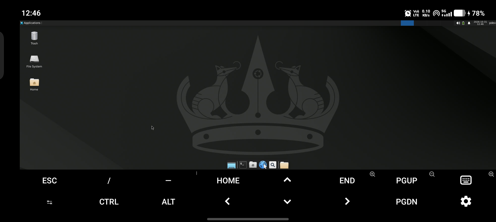

# Test report for v1.7.1

> Current development suite: `PASS=681 FAIL=0`.

## Wayland session, 2026-11-08

Verified on the Vivo V2437 (Android 16, SDK 36, aarch64) with the unreleased
Wayland changes.

| Check | Result |
|---|---|
| Host suite | `PASS=681 FAIL=0` |
| `lfa wayland install -i arch --resolution 2408x1080` | packages and profile installed |
| `lfa wayland start -i arch` | Termux:X11, Sway, Waybar, SwayNC, and SwayBG started |
| Nested output | `swaymsg` reported `2408x1080`; `grim` screenshot checked |
| Battery bridge | Waybar showed the Android percentage and charging state |
| `lfa wayland status -i arch` | `session: running (Sway)`, `drm: render=none` |
| Hyprland 0.57.1 | config parses; start aborts with `CBackend::create() failed!` because no writable render node exists |
| `lfa wayland stop -i arch` | compositor and bar processes removed |

The Wayland session uses Sway's X11 backend and the pixman renderer. Hyprland
cannot start on this device: `/dev/dri/card0` is `system:system` mode `660` and
`/dev/dri/renderD128` is absent. The Sway profile keeps the Hyprland keybinds,
gaps, borders, colours, and bar layout. See [WAYLAND.md](WAYLAND.md).

## Android storage, 2026-11-06

Verified on the Vivo V2437 (Android 16, SDK 36, aarch64) with the unreleased
storage changes.

| Check | Result |
|---|---|
| Host suite | `PASS=681 FAIL=0` |
| Thunar false X | gid 1023; folder icons normal; screenshot checked |
| `lfa storage exec` | shell and Python scripts from `/storage/emulated/0` ran from a `/tmp` copy |
| `lfa storage data` | adb at `127.0.0.1:5555`; `list` and `pull` worked for `Android/data` and `Android/obb`; guest read the copy |

The X was `emblem-unreadable`, not an access error. Android mounts the tree
as `1023:1023` with mode `2770`, and the desktop user was outside group 1023.
The fix makes gid 1023 the primary group. `chmod` stayed impossible because
the FUSE mount fixes the mode and is `noexec`.

Android 11 and later also deny `Android/data` and `Android/obb` to every app.
"All files access" did not help. adb runs as the shell user, so
`lfa storage data pull` copies the folders into shared storage. The copy is a
snapshot, not a mount.

## Android CI, SDK cutoffs, and compatibility layers, 2026-11-05

Verified on the Vivo V2437 (Android 16, SDK 36, aarch64, Termux 0.118.3,
proot-distro 5.10.3) and on the host. The emulator workflow is new and has
not run on GitHub Actions yet. The Oppo A37fw (Android 5.1, SDK 22) was off
the network during this pass, so the legacy-device rows remain pending.

| Check | Result |
|---|---|
| Host suite (`./tests/test-all.sh`) | `PASS=681 FAIL=0` |
| On-device VNC scenario (`termux-e2e.sh`) | `PASS=14 FAIL=0` |
| On-device Both → VNC/X11 switch | `PASS=22 FAIL=0` |
| On-device X11 scenario | `PASS=14 FAIL=0` |
| `bash -n` on the installer, libraries, tests, and CI helpers | clean |
| Matrix generator (`smoke` / `reduced` / `full`) | 6 / 23 / 674 scenarios, sharding validated |
| Python helpers | `py_compile` clean |
| SDK 24/25 boundary | X11 and Both refused; VNC selected; legacy repo path not used |
| `lfa compat` | systemctl, logind, upower, snap, and bwrap enabled and exercised; CPU Vulkan installed lavapipe; Alpine OpenCL refused honestly |
| `lfa android` | battery, clipboard, and notification bridge exercised; stalled Termux:API calls now time out instead of hanging |
| `lfa install --software` | Alpine CLI install with `python,git,htop`; `software-probe.sh` `PASS=12 FAIL=0 SKIP=10` |
| VirGL fallback | device GLX context failure detected; instance switched to llvmpipe; `xfwm4` stayed running |

### Device scenarios

| Scenario | Result |
|---|---|
| VNC start/stop | RFB port 5901 listening, Xvnc and xfce4-session running, port closed after stop |
| Both switch | VNC start, X11 start, X11 socket and `xdpyinfo`, switch back to VNC, shared Termux:X11 kept for the other instance |
| Android bridge | `lfa android status/test/refresh`, battery data, clipboard wrapper, queued notification and `pump` |
| Compatibility shims | `loginctl list-sessions`, `upower -d`, `snap list`, `bwrap -- /bin/echo`, `systemctl start/stop` |
| Software | `lfa install --software python,git,htop`; Python 3.14.10, Git 2.54.0, htop 3.5.3 |
| VirGL failure | initial xfwm4 `BadValue` with virpipe, automatic `NEED_VIRGL="0"` restart, llvmpipe GLX and live `xfwm4` |

### Device findings fixed in this pass

1. The E2E harness wrote logs to `/tmp`, which is read-only on Android; moved
   to `$TMPDIR`/`$PREFIX/tmp`.
2. `lfa status` crashed on a fresh install because its PID helper existed only
   in the generated launcher library.
3. X11 was reported as running for every instance because the check was global.
4. `start-linux --vnc` claimed success when port 5901 was not listening, and a
   VNC server owned by another instance was mistaken for this one.
5. VNC attached to a leftover Termux:X11 server on display `:1`, so `xfwm4`
   died with a GLX `BadValue`; each start now frees `:1` from the other backend.
6. VirGL could be present but unable to create a GLX context; LFA now falls
   back to llvmpipe once and records `NEED_VIRGL="0"`.
7. Termux:API helpers could hang the CLI; probes now time out and refresh only
   touches enabled capabilities.
8. `lfa compat status` showed `rootfs` instead of the instance name, and a
   failed Vulkan/OpenCL package install still marked the shim enabled.
9. `lfa remove` exited silently without deleting the instance because Android
   `du` returned non-zero while still printing a size; the size probe is now
   best-effort and the host suite covers the failure (`P2`).

### Device/emulator verification still required

- The PR smoke matrix on GitHub Actions (6 scenarios).
- Android 5/6 and Android 7.0/7.1 refusal paths on real devices or emulators.
- Real VNC RFB handshake and framebuffer pixel probe (`vnc-probe.py`) on the
  emulator image.
- The full 674-scenario sharded matrix.

The intended evidence is uploaded by `collect-artifacts.sh`: logcat,
`getprop`, a screenshot, `lfa-diagnostics.tar.gz`, `termux-logs.tar.gz`, and
the tail of `start-linux-session.log`.

## Both backends, 2026-11-04

Unreleased development verification on the Vivo V2437, Android 16 (SDK 36),
aarch64, Termux 0.118.3, proot-distro 5.10.3.

### Automated

| Check | Result |
|---|---|
| Host suite (`./tests/test-all.sh`) | `PASS=491 FAIL=0` |
| Device suite (`./tests/device-matrix.sh`) | `PASS=404 FAIL=0` (last device run before the CLI feature) |
| `bash -n` on the installer, libraries, and tests | clean |

### Device scenarios

| Scenario | Result |
|---|---|
| Guided setup, Ubuntu 24.04 + XFCE4 + Both (`bothdev`) | completed in 40m27s; `SERVER="both"` in setup.conf and the guest config |
| Installed packages | host `termux-x11-nightly`; guest `vncserver`, `Xvnc`, VNC password, XFCE session |
| First Both desktop start with blank input | `Invalid selection.`, no remembered-backend file, no server started |
| Start Termux:X11 | `termux-x11 :1`, `xfce4-session`; guest `xdpyinfo` reports display `:1` |
| Start VNC | `vncserver :1`, `xfce4-session`; RFB `003.008` banner on `127.0.0.1:5901` |
| Remembered choice | X11 and VNC were each preselected on the next start; blank input used the stored value |
| Terminal-only start | root shell opened and `last-server-<instance>` kept its previous value |
| `stop-linux`, X11 | `termux-x11` and `xfce4-session` gone; `.X11-unix` empty, no `.X1-lock` |
| `stop-linux`, VNC | `vncserver`, `Xtigervnc`, proot wrapper, and keepalive all gone |
| Menu 12 on an X11-only Ubuntu install | installed `tigervnc-standalone-server`, wrote Xstartup/password, set `SERVER="both"` |
| Menu 12 on a VNC-only config | enabled Termux:X11 as the second backend, set `SERVER="both"` |
| Backend added by Menu 12 | removed the stale remembered-backend file |
| `start-linux --server x11` / `--server vnc` | started the requested backend with no menu; invalid value exited 1 |
| Guided Both autostart prompt | offered VNC, Termux:X11, and None; cancelling the summary changed nothing |

### Findings fixed during device testing

1. N3 assumed `termux-x11` was missing. On a device that already has it, the
   test took the "already installed" branch and failed. The test now removes
   the real Termux prefix from `PATH` for that case.
2. `stop-linux` left the VNC proot wrapper and `sleep 3600` loop alive after
   the X server was gone. The keepalive is now `exec sleep 2147483647`, and
   stop escalates to SIGKILL if the wrapper does not exit.
3. Menu 12 warned that `tigervnc` was missing on a healthy Both install.
   `vncserver` and `Xvnc` are absolute symlinks into `/etc/alternatives`;
   the host-side check followed them into the host's `/etc`. Guest checks now
   accept symlinks.

Not exercised on hardware in this pass: Android 5/6 display-server hiding,
GNOME with Both, and the actual Termux:Boot reboot path. Those remain covered
by the stubbed host suite only.

## CLI, switching, and removal, 2026-11-04

Host verification only in this pass. The new commands are exercised with the
stubbed Termux environment; the next device pass should repeat the switch
matrix on the Vivo and the refusal path on the Oppo. The Oppo was not
reachable over SSH during this pass, so its Android 5 path is covered by the
stub suite only.

| Check | Result |
|---|---|
| Host suite (`./tests/test-all.sh`) | `PASS=491 FAIL=0` |
| `lfa` runtime copy and wrappers | `lfa`, `linux`, `switch-linux`, `autostart-linux`, `lfa-lib.sh` generated |
| `lfa install --backend both -i <name>` | `SERVER="both"`, desktop config, JSON status |
| `lfa switch x11 --remove-old` | guest TigerVNC package removal, VNC config deleted, config `SERVER="x11"` |
| `lfa switch vnc --remove-old --force` | host `termux-x11-nightly` removed, config `SERVER="vnc"` |
| Shared Termux:X11 | refused without `--force`; config left on `both` |
| Boot script ownership | switching another instance does not rewrite a boot script that targets a different one |
| `lfa autostart vnc|none` | boot script and `DO_AUTOSTART` updated |
| `lfa notice off|on|status` | preference file and reported state round-trip |
| Explicit `-i` | invalid name exits 1 in `start-linux`, `terminal-linux`, and `stop-linux` |
| Non-interactive Both start | exits 1 with "no default is remembered" instead of guessing |
| Android 5/6 switch/install to X11 or Both | refused with explanation, `--remove-old` warning, and VNC restore command |

The test suite now also runs a `lfa shell -i <name> --root` case to prove that
option order does not drop the instance.

## Android 5 legacy verification, 2026-11-04

Device: Oppo A37fw, Android 5.1.1 (SDK 22), aarch64, 2 GB RAM, 3.6 GB free.
Termux runs the frozen Android 5 repositories; proot-distro v4.2.0 was
installed from source by the installer.

| Check | Result |
|---|---|
| Device suite (`./tests/device-matrix.sh`) | `PASS=404 FAIL=0` (last device run before the CLI feature) |
| Guided setup menu | `LEGACY MODE: Android 5/6 detected`; X11 and Both absent; VNC selected automatically |
| Fresh install, Alpine 3.18 + XFCE4 + VNC (`legacyvnc`) | completed in 9m38s; 3686 MB free reported, 2500 MB needed |
| Guest packages | `vncserver`, `Xvnc`, `xfce4-session`, VNC password, Xstartup |
| VNC desktop | RFB `003.008` on `127.0.0.1:5901`; `Xvnc`, `xinit`, and `xfce4-session` running |
| `stop-linux` | Xvnc, vncserver, xinit, xfce4-session, and the proot wrapper all gone; `.X11-unix` empty |
| Existing `SERVER="both"` config run through Menu 12 | clamped to `SERVER="vnc"`, `AUTOSTART_SERVER="vnc"`, remembered choice removed |
| `start-linux` after clamping | showed only `Desktop available: xfce4 via vnc`; no X11/Both menu |

The legacy suite needed `python3` for the test shims; it was installed from the
main Termux repository. The installer itself does not use Python.

### Findings fixed on Android 5

1. Toybox `df` does not accept `-Pk` and reports `10.8G 7.2G 3.6G`. The
   preflight parsed `3.6` as zero blocks and refused the install. `lfa_free_mb`
   now uses `stat -f`, then the human value.
2. Alpine's TigerVNC `vncserver` has no `-kill`. Its Xvnc re-parents to init
   and survives the proot wrapper, so stop left the desktop running. Stop now
   kills the managed `:1` processes with anchored patterns.
3. The first fallback pattern was unanchored and killed the invoking SSH
   shell. Patterns now match `argv[0]` only.
4. Menu 12's legacy clamp changed `SERVER` in memory only. It now persists
   `vnc`, forces the autostart backend to VNC, and clears the remembered choice.

## v1.7.1 verification, 2026-11-01

This release is a hardening pass based on the audit in `issues.md`: 54
findings, with 38 fixed, 11 partial, and 5 deferred. See `tracker.md`.
Post-release findings #55 to #57 were fixed in v1.7.1.

### Automated

| Check | Result |
|---|---|
| Host suite (`./tests/test-all.sh`) | `PASS=356 FAIL=0` |
| `shellcheck -S warning install_linux.sh lib/*.sh tests/*.sh` | clean |
| `bash -n` and `sh -n` on every script | clean |
| CLI surface (`--version`, `--help`, unknown option) | exit 0, 0, 2 |
| CI workflow (`.github/workflows/ci.yml`) | runs the three checks above on push and PR |

New behavioural tests cover stale display `:1` release and live-server respect
(M4), pidfile command-line verification (M6), disk-space refusal (M7), and
interrupt cleanup of the secret-bearing setup script (M8). The v1.6.1 GNOME
system-bus and locale checks are also included.

### Device: Vivo V2437, Android 16 (SDK 36), aarch64

The repository was copied to `~/Linux-For-Android` in Termux, and every check
below ran on the phone itself over SSH with `LFA_VERSION="1.7.1"`.

| Check | Result |
|---|---|
| `./tests/test-all.sh` on the phone | `PASS=356 FAIL=0` |
| `./install_linux.sh --version` | `Linux for Android Manager 1.7.1` |
| `./install_linux.sh --help` | lists all flags, exit 0 |
| `./install_linux.sh --list` | `ubuntu` |
| `./install_linux.sh --diagnostics` | bundle written, `report.txt` and redacted config, mode 0600 |
| Menu 12 on the existing Ubuntu install | statoverride sanitised, snapd pinned off, launchers regenerated |
| `start-linux` (Ubuntu 24.04, XFCE4, Termux:X11) | desktop live; `xfce4-session`, `xfwm4`, `xfce4-panel`, and `xfdesktop` running |
| `stop-linux` | `termux-x11` gone, `.X11-unix` empty, `.X1-lock` removed |
| Alpine CLI install and uninstall | installed in 5m11s, `user` and sudo ritual present; uninstall removed the rootfs, pidfile, log, and runtime dir (#49) |
| Documentation gate (Z) | guide present, both index links resolve, every relative doc link resolves |
| Every install-menu application (v1.7.1) | Python 3.12.3, Git 2.43.0, Node 26.13.0/npm 11.20.0, curl 8.5.0, wget 1.21.4, neofetch 7.1.0, htop 3.3.0, VS Code 1.144.0, Firefox, Chromium, LibreOffice 24.2, VLC, GIMP, and Antigravity all launch |

Screenshot from 2026-10-31 on a real device:

#### A note on the test environment

The first device runs appeared to wedge `sshd`. New connections reached the
listener but never received a banner, and `sshd` kept `CLOSE_WAIT` sockets
with no child process. The cause was Android's phantom-process killer. An XFCE
session plus the stub test suite pushes Termux past the default child-process
limit, and Android silently kills the surplus processes, including `sshd`.
Disabling the monitor
(`settings put global settings_enable_monitor_phantom_procs false`, the same
change the README asks users to make in Developer options) made the device
stable for the whole run. The troubleshooting section documents this as the
phantom process killer. It is a device setting, not a project defect.

Previous hardware results for v1.6.1 and earlier are recorded below.

Live validation on two physical devices, 28 and 29 October 2026. Every item
below was reproduced on hardware, fixed, then re-verified on the device.
Nothing in this report is inferred from the unit suite alone.

- Suite: `tests/test-all.sh`, `PASS=273 FAIL=0` on host, Vivo, and Oppo
- Versions: v1.5.6 and v1.5.7
- Scope: X11 (Termux:X11) and VNC, all 8 supported distributions, plus Android
  5.1.1 legacy mode

## Devices

| | Vivo V2437 | Oppo A37fw |
|---|---|---|
| Android | 16 (SDK 36) | 5.1.1 (SDK 22) |
| ABI and kernel | aarch64, 6.1.145 | aarch64, 3.10 |
| RAM | 7.5 GB plus 8 GB swap | 1.8 GB, no swap |
| proot-distro | v4 (containers layout) | 4.2.0 (installed-rootfs layout) |
| Backend | Termux:X11 and VNC | VNC only |

## Defects found and fixed

### Desktop startup

| # | Defect | Root cause | Fix |
|---|---|---|---|
| 1 | Black desktop, "Unable to contact settings server" on openSUSE and Arch | `dbus-launch`'s forked daemon dies immediately under proot | Launchers use `dbus-run-session -- <session>`; `dbus-launch` remains as a fallback |
| 2 | No session at all on openSUSE | `/etc/machine-id` empty and read-only | Generated once per rootfs during install and menu 12 |
| 3 | `start-linux` hangs on a dead desktop after switching distros | Shared `$PREFIX/tmp` keeps dead D-Bus and `/tmp/.X11-unix/X1` sockets | Cleared before each X11 start, only when no `termux-x11 :1` is running |

### Image decoding

| # | Defect | Root cause | Fix |
|---|---|---|---|
| 4 | Whole session aborts with `Gtk:ERROR ... Bail out!` on Kali, Arch, Fedora, and Void | glycin decodes PNG and JPEG in a bubblewrap sandbox; proot cannot create namespaces | `/usr/local/bin/bwrap` shim triggers glycin's unsandboxed fallback |
| 5 | Every icon missing on Fedora 44 and Void | gdk-pixbuf ships without PNG and JPEG backends | `glycin-loaders` or `glycin-loaders-all` installed when available |

### Wallpaper

| # | Defect | Root cause | Fix |
|---|---|---|---|
| 6 | First login is black until the wallpaper is re-applied | Applier ran before xfdesktop created its backdrop keys | Waits for `workspace*/last-image`, seeds `monitorscreen`, and nudges `xfdesktop --reload` |
| 7 | No wallpaper on Arch | No `xrandr`, so the real connector was never seeded | Seeding no longer depends on `xrandr` |

### Distro specific

| # | Distro | Defect | Fix |
|---|---|---|---|
| 8 | openSUSE Tumbleweed | `dbus-1-x11` removed upstream, install failed three times | `dbus-1-daemon dbus-1-tools` |
| 9 | Void | No fonts, text rendered as boxes | `dejavu-fonts-ttf` |
| 10 | Void | No `vncserver` wrapper, VNC could not start | Direct `Xvnc` fallback with the same password, geometry, and session |
| 11 | All VNC | TigerVNC 1.15 and later rejects `-geometry` | Geometry written to `~/.vnc/config` and `~/.config/tigervnc/config` |
| 12 | Alpine on Android 5/6 | Image ships edge repos; edge glib and GTK abort on kernel 3.10 with `ENOSYS` | Legacy installs pin `v3.18`, use a minimal XFCE set and `font-dejavu` |

Legacy Alpine went from 11m13s and 956 MB with a crashing desktop to 3m32s and
204 MB with a working VNC desktop.

## Install and live-desktop matrix (Vivo, XFCE, Termux:X11)

| Distro | Install | Time | Size | Live desktop |
|---|---|---|---|---|
| Ubuntu 24.04 | pass | n/a | 1.9 G | pass, light and dark, clean first login |
| Kali Rolling | pass | 38m | 1.8 G | pass |
| Fedora 44 | pass | 12m | 1.1 G | pass |
| openSUSE Tumbleweed | pass | 11m | 831 M | pass |
| Arch Linux ARM | pass | 18m | 1.6 G | pass |
| Void Linux | pass | 10m | 1.1 G | pass |
| Alpine edge | pass | 3m | 649 M | partial: desktop and wallpaper render, `xfce4-panel` does not start |
| Debian (CLI) | pass | n/a | 195 M | CLI only, by design |

VNC was verified live on Void with direct `Xvnc` and on legacy Alpine 3.18 on
the Oppo. The wallpaper, panel, clock, and menus were correct.

## Android 5.1.1 (Oppo A37fw)

- `debian-4452` CLI: realistic prompt, `hostname`, ritual `sudo` password
  prompt, and an in-place upgrade through menu 12 applied cleanly.
- `lfa5` (Alpine 3.18, XFCE, VNC): 3m32s, 204 MB, desktop confirmed by
  screenshot.

## Known limitations

- Alpine edge on the Vivo: the session and wallpaper render, but
  `xfce4-panel` does not start. This did not reproduce on legacy Alpine 3.18,
  which works. It appears to be an edge packaging issue rather than a launcher
  issue.
- Void over VNC: the window manager and desktop start, but the panel is
  inconsistent. Void over X11 works.
- Wayland is not supported. All work targets X11 or VNC.
- GNOME is experimental. It was validated on the Vivo (Android 16) with Ubuntu
  24.04 and GNOME 46. `gnome-shell --x11` renders over both Termux:X11 and
  VNC, and `gnome-terminal` and Nautilus launch from the session. Session
  services such as logind, portals, and the session manager are still absent,
  so login and logout, screen locking, and settings panels remain broken. Two
  proot patches are documented in the README: a private system D-Bus, without
  which the shell dies with "A connection to the bus can't be made", and a
  UTF-8 locale published to the session bus, without which GTK apps exit with
  status 8. First-login overview and black window shadows under software
  rendering are cosmetic and expected.
